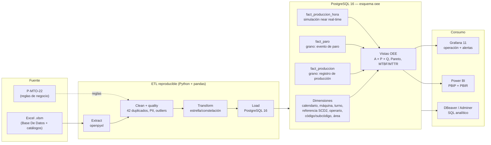

# OEE Envasado — Solución de BI end-to-end

Solución contenerizada de Inteligencia de Negocios para las cuatro líneas de
envasado de vinilos y témperas (`Vinilos_1` a `Vinilos_4`). Integra el registro
histórico del formato **P-MTO-22 / hora a hora**, lo limpia, lo modela en estrella
sobre PostgreSQL y habilita dos capas de consumo:

- **Grafana**: operación *near real-time*, estado por máquina y alertas.
- **Power BI**: análisis estratégico, tendencias, Pareto y comparativos anuales.

> **Datos fuente**: `SEGUIMIENTO TEMPERAS Y VINILOS Actividad.xlsm` y
> `P-MTO-21-V1_Registro_paros_de_produccion_actividad.pdf`. Por confidencialidad
> y tamaño, la carpeta `docs/` y los archivos crudos **no se versionan**
> (ver `.gitignore`). Copiarlos a `data/raw/` antes de ejecutar el ETL.

---

## 1. Arquitectura



**Decisiones de arquitectura** (justificación completa en
`documentacion/09_arquitectura_seguridad.md`):

| Decisión | Elección | Por qué |
|---|---|---|
| Motor | PostgreSQL 16 | Ventanas, CTE, `FILTER`, vistas, tipos numéricos exactos, excelente conector Grafana/Power BI. |
| ETL | Python + pandas + psycopg2 | Reproducible, testeable, sin licencias, corre en Docker, lee `.xlsm` sin ejecutar macros. |
| Modelo | Estrella/constelación (Kimball) | Dos procesos de negocio (producción y paros) comparten dimensiones; el OEE se calcula por agregación. |
| SCD | Tipo 2 en `dim_referencia` | La conversión unidades/paca puede cambiar con el empaque; la historia debe conservar la versión vigente. |
| Power BI | PBIP + PBIR + `model.bim` (TMSL) | Texto diffable, revisable en Git, sin `.pbix` binario. |
| Grafana | Provisioning como código (YAML + JSON) | Tablero, datasource y alertas reproducibles desde cero. |
| Secretos | `.env` + `.env.example` | Nada de credenciales en Git. |

---

## 2. Estructura del repositorio

```
.
├── README.md
├── Makefile
├── docker-compose.yml
├── .env.example
├── .gitignore
├── db/
│   ├── init/                 # roles, DDL, calendario y permisos
│   └── queries/              # 12 consultas analíticas con ventanas
├── etl/
│   ├── run_etl.py            # orquestador
│   ├── extract.py
│   ├── clean.py
│   ├── transform.py
│   ├── load.py
│   ├── quality.py
│   ├── reconcile.py
│   ├── simulate_realtime.py  # simulador + webhook de alertas
│   ├── tests/
│   ├── Dockerfile
│   └── requirements.txt
├── grafana/
│   ├── provisioning/         # datasource, dashboards y alertas
│   └── dashboards/oee_operativo.json
├── powerbi/
│   ├── OEE_Vinilos.pbip
│   ├── OEE_Vinilos.SemanticModel/
│   ├── OEE_Vinilos.Report/
│   ├── DAX_medidas.md
│   └── screenshots/
├── scripts/
│   ├── build_grafana_dashboard.py
│   └── build_powerbi.py
├── data/
│   ├── raw/                  # .xlsm y PDF (ignorados)
│   ├── processed/
│   └── private/              # mapeos PII locales (ignorados)
├── documentacion/            # diagnóstico, KPIs, modelo, diccionario, etc.
└── informe/                  # informe final + capturas
```

---

## 3. Reproducción desde cero

### Requisitos

- Docker 24+ y Docker Compose v2.
- 4 GB de RAM libres.
- Power BI Desktop (Windows) solo para abrir/refrescar el PBIP.
- DBeaver/Adminer para explorar SQL (opcional).

### Pasos

```bash
# 1. Configurar secretos
cp .env.example .env
# editar .env y cambiar TODAS las contraseñas y PII_SALT

# 2. Copiar la fuente (no se versiona)
mkdir -p data/raw
cp "docs/SEGUIMIENTO TEMPERAS Y VINILOS Actividad.xlsm" data/raw/
cp "docs/P-MTO-21-V1_Registro_paros_de_produccion_actividad.pdf" data/raw/

# 3. Levantar PostgreSQL + Grafana
make up

# 4. Ejecutar el ETL (crea dimensiones, hechos, calidad y conciliación)
make etl

# 5. Simulador near real-time + webhook de alertas
make sim

# 6. Abrir Grafana
#    http://localhost:3000  (usuario/contraseña de .env)
#    Dashboard: OEE → "OEE Envasado — Operación near real-time"
```

**Reconstrucción total** (borra volúmenes y vuelve a ejecutar todo):

```bash
make reset
make up
make etl
make sim
```

**Pruebas unitarias del ETL**:

```bash
make test
```

**DBeaver / Adminer**:

- Host: `localhost`, puerto `5432`, base `oee_bi`.
- Usuario de solo lectura: `oee_bi` / contraseña `OEE_BI_PASSWORD`.
- Usuario ETL: `oee_etl` (solo para cargas).
- Adminer: `make adminer` → `http://localhost:8081`.

---

## 4. Resultados de la carga (conciliación)

| Métrica | Fuente bruta | Después de deduplicar | Cargado | Diferencia |
|---|---:|---:|---:|---:|
| Filas | 8.208 | 8.166 | 8.166 staging | 0 |
| Registros de producción | 5.157 | 5.137 | 5.137 | 0 |
| Eventos de paro | 16.532 | 16.482 | 16.482 | −50 (50 eventos en filas duplicadas) |
| Pacas producidas | 378.778 | 377.759 | 377.759 | 0 |
| Horas trabajadas | 38.063,35 | 37.934,35 | 37.934,35 | 0 |
| Horas de paro | 8.449,65 | 8.431,54 | 8.431,54 | 0 |

Las diferencias bruto → deduplicado corresponden exactamente a **42 filas
duplicadas exactas** (1.019 pacas, 129 horas, 18,12 h de paro). La columna
`Tiempo de Paro` coincide con la suma de los 18 pares código/horas en el 100 %
de las filas. Ver `documentacion/05_etl_calidad.md`.

**OEE histórico (rendimiento con tope al 100 %, calidad = 100 %):**

| Año | Disponibilidad | Rendimiento | OEE | Cobertura de referencia |
|---|---:|---:|---:|---:|
| 2023 | 62,8 % | 100,0 % | 62,8 % | 23,0 % |
| 2024 | 72,6 % | 97,8 % | 71,0 % | 98,5 % |
| 2025 (ene–mar) | 70,2 % | 100,0 % | 70,2 % | 100,0 % |

| Máquina | Disponibilidad | Rendimiento | OEE | MTBF (h) | MTTR (h) |
|---|---:|---:|---:|---:|---:|
| Vinilos_1 | 65,9 % | 95,6 % | 63,0 % | 2,95 | 0,73 |
| Vinilos_2 | 60,3 % | 55,8 % | 33,7 % | 2,54 | 0,84 |
| Vinilos_3 | 73,6 % | 100,0 % | 73,6 % | 3,85 | 0,59 |
| Vinilos_4 | 75,5 % | 100,0 % | 75,5 % | 3,94 | 0,60 |

> El OEE de 2022 no se calcula: el 100 % de los registros de ese año no tienen
> referencia, por lo que no hay conversión unidades/paca. Es una limitación de
> la fuente, no del modelo. **Vinilos_2** es la línea con peor rendimiento y la
> principal oportunidad de mejora.

---

## 5. Contenido de la documentación

| Documento | Contenido |
|---|---|
| `documentacion/01_diagnostico.md` | Stakeholders, preguntas de negocio, diagnóstico de la fuente y calidad. |
| `documentacion/02_requerimientos_kpis.md` | Catálogo de KPIs (fórmula, unidad, granularidad, meta, fuente, usuario) y KPIs nuevos. |
| `documentacion/03_modelo_dimensional.md` | Grano, dimensiones, jerarquías, bus matrix, SCD y justificación Kimball. |
| `documentacion/04_diccionario_datos.md` | Diccionario y lineage fuente → destino de cada tabla. |
| `documentacion/05_etl_calidad.md` | Reglas de limpieza, conteos antes/después, conciliación y hallazgos. |
| `documentacion/06_consultas_sql.md` | Consultas analíticas con `RANK`, `LAG`, `SUM() OVER`, comparativos. |
| `documentacion/07_grafana.md` | Tablero, variables, alerta, simulación y evidencias. |
| `documentacion/08_powerbi.md` | Modelo semántico, DAX, páginas, RLS y formato PBIP/PBIR. |
| `documentacion/09_arquitectura_seguridad.md` | Arquitectura, Grafana vs Power BI, gobierno, PII y seguridad. |
| `documentacion/10_evolucion_scada.md` | Evolución a PLC/SCADA, OPC UA/MQTT, streaming y series de tiempo. |
| `documentacion/11_guia_apropiacion.md` | **Guía interna para dominar el proyecto**: data, métricas, accesos, demo y preguntas del jurado. |
| `informe/informe.md` | Informe final con portada, capturas y checklist. |

---

## 6. Seguridad y datos personales

- Los nombres de operarias y personal de mantenimiento **nunca** se cargan a la
  base: se seudonimizan con `SHA-256(salt + nombre)` y un seudónimo `OP-xxxxxxxx`
  / `PM-xxxxxxxx`. El texto libre se redacta con `[PERSONA]`.
- Contraseñas y cadenas de conexión viven en `.env` (ignorado). El repositorio
  solo incluye `.env.example`.
- Roles PostgreSQL de mínimo privilegio: `oee_etl` (carga), `oee_bi` (lectura),
  `oee_grafana` (lectura). RLS de Power BI por línea (`Supervisor_Vinilos_1..4`).
- Grafana usa autenticación propia; el datasource usa el rol `oee_grafana`.

---

## 7. Limitaciones y supuestos

1. **Calidad = 100 %**: la fuente no captura unidades rechazadas; el OEE se
   calcula como `A × P × 1`. Se propone añadir `unidades_rechazadas` al formato.
2. **Referencia faltante**: 49,7 % de los registros de producción no tienen
   referencia; el OEE solo se calcula sobre el subconjunto con conversión
   unidades/paca conocida. La cobertura se muestra en todos los tableros.
3. **Turno faltante**: 4.218 filas no tienen turno; se agrupan en `SD` y no se
   imputan a un turno específico.
4. **Subcódigos**: solo los códigos 1, 3 y 5 tienen subcódigo en el formato;
   el resto usa `SIN_ESP`. El 78,3 % de los eventos no tiene subcódigo.
5. **Rendimiento > 100 %**: 58 % de las observaciones día/máquina superan el
   estándar de 72 u/min; se marca y se aplica tope al 100 % para el OEE oficial,
   y se conserva `rendimiento_calculado` para diagnosticar el estándar.
6. **`Horas no trabajadas`**: es un dato a nivel día, con semántica inconsistente;
   no se usa en el OEE (se conserva en `fact_produccion` para trazabilidad).
7. **Datos personales en texto libre**: se redactan los nombres conocidos, pero
   el área debe revisar observaciones antes de publicar.

---

## 8. Integrantes

| Nombre | Rol |
|---|---|
| _Completar_ | _Completar_ |
| _Completar_ | _Completar_ |
| _Completar_ | _Completar_ |

**Repositorio:** _completar con la URL de GitHub al publicar_.
