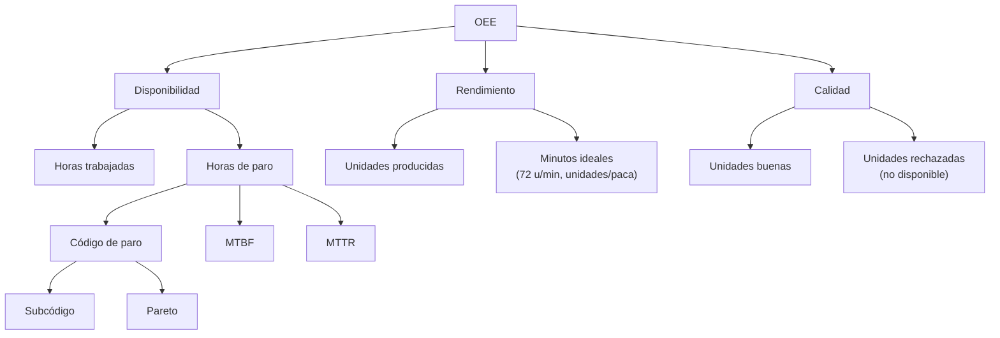

# 02. Catálogo de indicadores (KPIs)

## 1. Indicadores que reporta hoy el P-MTO-22 / Excel

El procedimiento y las tablas dinámicas actuales reportan, por máquina, mes y
año: producción, horas trabajadas, horas de paro, porcentaje de códigos de paro
y análisis detallado de los códigos 01, 03 y 05. No calculan OEE ni sus
componentes.

| # | Indicador actual | Fórmula / definición | Unidad | Granularidad | Fuente | Usuario |
|---|---|---|---|---|---|---|
| A1 | Producción general | `Σ pacas producidas` | pacas | Mes / año | `Base De Datos` | Gerencia |
| A2 | Producción por máquina | `Σ pacas` por `Maquina` | pacas | Mes / año / máquina | `Base De Datos` | Gerencia, Producción |
| A3 | Producción por referencia | `Σ pacas` por `Referencia` | pacas | Mes / referencia | `Base De Datos` | Producción |
| A4 | Horas trabajadas | `Σ Horas trabajadas` | horas | Mes / máquina | `Base De Datos` | Producción |
| A5 | Horas de paro | `Σ Tiempo de Paro` | horas | Mes / máquina | `Base De Datos` | Mantenimiento |
| A6 | Porcentaje de códigos de paro | `horas código i / Σ horas paro` | % | Mes / máquina / código | `Base De Datos` | Mantenimiento |
| A7 | Análisis códigos 01, 03 y 05 | horas y subcódigos de 1, 3, 5 | horas / % | Mes / máquina / subcódigo | `TABLA CODIGOS` + `Base De Datos` | Mantenimiento |
| A8 | Comparativo 2024 vs 2025 | `Σ pacas 2024` vs `Σ pacas 2025` | pacas / % | Año / máquina | Tablas dinámicas | Gerencia |

## 2. Indicadores nuevos propuestos

| # | KPI | Fórmula | Unidad | Granularidad | Meta / umbral | Fuente | Usuario | Justificación |
|---|---|---|---|---|---|---|---|---|
| N1 | **OEE** | `Disponibilidad × Rendimiento × Calidad` | % | Día / mes / máquina / turno | Meta 75 %; clase mundial 85 %; alerta < 60 % | `vw_oee_diario_maquina` | Gerencia, Producción | Métrica única de eficiencia; permite comparar líneas y priorizar inversión. |
| N2 | **Disponibilidad** | `(horas trabajadas − horas paro) / horas trabajadas` | % | Día / mes / máquina / turno | Meta 85 %; alerta < 70 % | `fact_produccion` + `fact_paro` | Producción, Mantenimiento | Separa la pérdida por paros de la pérdida por velocidad. |
| N3 | **Rendimiento** | `unidades producidas / (minutos operativos × 72 u/min)` | % | Día / mes / máquina / turno | Meta 90 %; alerta < 75 % | `fact_produccion` + catálogo | Producción | Detecta pérdidas por microparos y velocidad; con tope al 100 % para el OEE oficial. |
| N4 | **Calidad** | `unidades buenas / unidades producidas` | % | Día / mes / máquina | Meta 99 % | **No disponible**; se asume 100 % | Calidad | Completa el OEE; requiere capturar rechazos. |
| N5 | **MTBF** | `horas operativas / número de fallas no programadas` | horas | Mes / máquina | ≥ 4 h (referencia interna) | `fact_paro` + `vw_mtbf_mttr` | Mantenimiento | Mide confiabilidad; complementa el Pareto de horas. |
| N6 | **MTTR** | `horas de paro no programado / número de fallas` | horas | Mes / máquina | ≤ 0,75 h | `fact_paro` + `vw_mtbf_mttr` | Mantenimiento | Mide velocidad de respuesta; distingue “falla mucho” de “tarda mucho”. |
| N7 | **Pareto de paros** | horas por código/subcódigo, ordenadas y acumuladas | horas / % | Mes / máquina / código | 80 % de horas en ≤ 20 % de causas | `fact_paro` + `vw_pareto_paros` | Gerencia, Mantenimiento | Enfoca el plan de mejora en pocas causas. |
| N8 | **Cobertura de referencia** | `horas con referencia / horas totales` | % | Día / mes / máquina | ≥ 90 % | `vw_oee_diario_maquina` | TI, Producción | Indica qué tan confiable es el rendimiento/OEE. |
| N9 | **Eventos de paro** | `COUNT(*)` de eventos | eventos | Día / mes / máquina / código | ≤ 2 por turno | `fact_paro` | Supervisión | Mide frecuencia, no solo duración. |
| N10 | **OEE YTD** | `OEE acumulado del año` | % | YTD / máquina | Meta 75 % | DAX / SQL | Gerencia | Sigue el compromiso anual sin esperar el cierre. |
| N11 | **Variación OEE YoY** | `OEE actual − OEE año anterior` | pp / % | Mes / máquina | ≥ 0 pp | DAX | Gerencia | Mide si la mejora es real o estacional. |
| N12 | **OEE por turno** | OEE agregado por turno | % | Mes / turno | ≥ 70 % | `vw_oee_turno` | Producción | Detecta brechas de desempeño entre turnos. |
| N13 | **OEE por referencia** | `unidades / minutos ideales` por referencia | % | Mes / referencia | ≥ 80 % | `fact_produccion` | Producción, Comercial | Identifica referencias que consumen más horas-máquina. |
| N14 | **Tasa de paro** | `horas paro / horas trabajadas` | % | Día / mes / máquina | ≤ 15 % | `fact_paro` | Supervisión | Complemento directo de disponibilidad. |
| N15 | **Horas de paro por área** | horas por área de impacto | horas | Mes / área | Reducción 10 % anual | `fact_paro` + `dim_area` | Gerencia | Permite asignar el problema al área responsable. |

## 3. Metas y umbrales

Los umbrales se proponen con base en la práctica de manufactura y se calibran
con el histórico:

| KPI | Meta | Alerta | Fundamento |
|---|---:|---:|---|
| OEE | 75 % | < 60 % sostenido 1 min | 85 % es clase mundial; 75 % es una meta alcanzable para envasado; 60 % es el límite de control inferior (meta − 15 pp). |
| Disponibilidad | 85 % | < 70 % | El histórico 2024–2025 está en 70–73 %; 85 % exige reducir paros no programados. |
| Rendimiento | 90 % | < 75 % | El histórico agregado es ~98 % con tope; la alerta busca caídas de velocidad. |
| Calidad | 99 % | < 97 % | Aún no medible; se propone al habilitar rechazos. |
| MTBF | ≥ 4 h | < 2 h | El histórico está en 2,5–3,9 h; 4 h es una mejora de 10–60 %. |
| MTTR | ≤ 0,75 h | > 1 h | El histórico está en 0,6–0,84 h. |
| Cobertura de referencia | ≥ 90 % | < 70 % | Sin referencia no hay OEE confiable. |
| Pareto | 80 % en ≤ 20 % causas | — | Regla 80/20 para priorizar. |

> **Nota:** la alerta de Grafana usa OEE < 60 % durante 1 minuto. En producción
> se recomienda 5–10 minutos para evitar ruido; en la demo se usa 1 minuto para
> que la reacción sea observable.

## 4. Árbol de KPIs

## 5. Frecuencia y consumidor

| Capa | KPI | Frecuencia | Consumidor |
|---|---|---|---|
| Operativa | OEE, A, P, paros, estado | 10 s–1 min | Supervisor, mantenimiento |
| Táctica | OEE por turno, referencia, Pareto | Diaria / semanal | Jefatura de Producción, Mantenimiento |
| Estratégica | OEE YTD, YoY, Pareto anual, MTBF/MTTR | Mensual | Gerencia, comité |
| Gobierno | Cobertura, conciliación, calidad | Por corrida ETL | TI / Datos |
