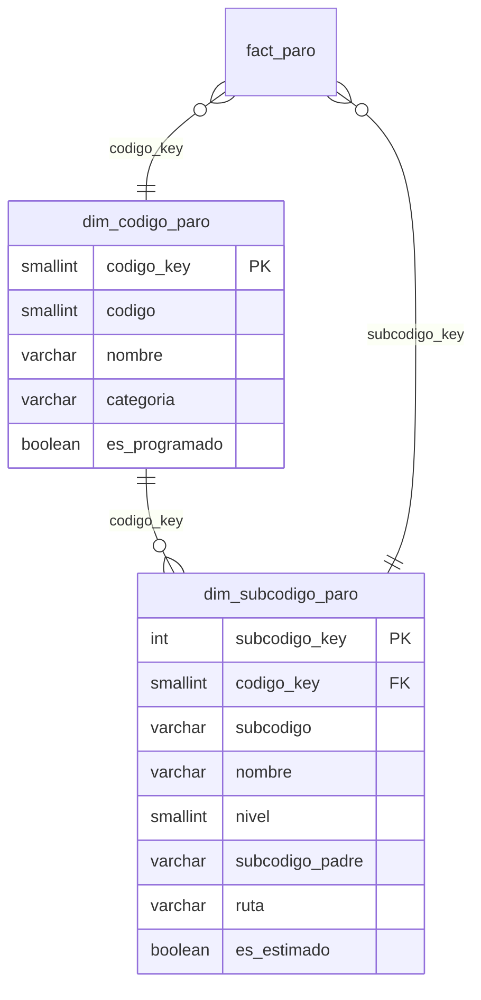
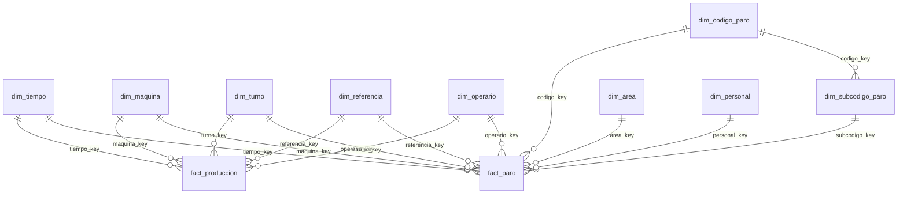

# 03. Modelo dimensional

## 1. Elección: estrella / constelación (Kimball)

Se implementa un **esquema en constelación** con dos tablas de hechos que
comparten dimensiones conformadas:

- `fact_produccion`: proceso **producción**.
- `fact_paro`: proceso **paros**.

No se usa una única tabla de hechos ancha porque producción y paros ocurren con
granularidades distintas: una fila de producción puede tener 0..18 eventos de
paro y una fila hija de paro puede no tener producción. Unir ambos en una sola
tabla duplicaría pacas/horas por cada paro (fan-out) y rompería la conciliación.
La constelación permite **drill-across** por dimensiones conformadas y calcular
el OEE agregando cada hecho a su nivel.

**¿Por qué Kimball y no un modelo normalizado 3NF?** Porque el consumo es
analítico (tableros, agregaciones, comparativos) y el volumen es pequeño (~8 k
filas). Las estrellas son más simples de entender para el negocio, más rápidas
para Power BI/Grafana y permiten aislar las reglas de negocio en el ETL.

## 2. Grano de cada tabla

| Tabla | Grano declarado | Clave natural | Filas cargadas |
|---|---|---|---:|
| `fact_produccion` | Un **registro de producción**: una fila del Excel con pacas u horas, después de deduplicar. | `origen_fila` | 5.137 |
| `fact_paro` | Un **evento de paro**: una fila de origen × una columna de código (1..18) con minutos > 0. | `(origen_fila, origen_columna)` | 16.482 |
| `fact_produccion_hora` | Un **minuto simulado** por máquina (near real-time). | `(ts_hora, maquina_key)` | variable |
| `vw_oee_diario_maquina` | Un **día × máquina** (vista agregada). | `(tiempo_key, maquina_key)` | ~2.680 |
| `vw_oee_mensual_maquina` | Un **mes × máquina**. | `(anio, mes, maquina_key)` | ~74 |
| `vw_oee_turno` | Un **mes × turno**. | `(anio, mes, turno_key)` | ~70 |
| `vw_pareto_paros` | Un **mes × máquina × código × subcódigo**. | `(anio, mes, maquina_key, codigo_key, subcodigo_key)` | ~2.000 |
| `vw_mtbf_mttr` | Un **día × máquina**. | `(tiempo_key, maquina_key)` | ~2.680 |

> El grano de `fact_produccion` **no** es “día × máquina × turno”: una misma
> máquina/turno puede tener varias referencias u operarias. El día × máquina se
> obtiene por agregación en la vista, que es donde se calcula el OEE.

## 3. Dimensiones

| Dimensión | Atributos principales | Jerarquías | Construida por |
|---|---|---|---|
| `dim_tiempo` | fecha, año, trimestre, mes, día, semana ISO, fin de semana | Año → Trimestre → Mes → Día | **Sí** (calendario generado) |
| `dim_maquina` | código, nombre, factor legacy, activa | — | Catálogo + ETL |
| `dim_turno` | código, nombre, hora inicio/fin, duración, nocturno | — | **Sí** (normalización) |
| `dim_referencia` | referencia, colores, unidades/display, unidades/paca, velocidad ideal, vigencia, versión | Familia → Referencia → Versión | Catálogo + reglas |
| `dim_operario` | seudónimo, hash, activo, válido | — | **Sí** (seudonimización) |
| `dim_codigo_paro` | código, nombre, área, categoría, programado, documentado | Área → Categoría → Código | Catálogo P-MTO-22 |
| `dim_subcodigo_paro` | subcódigo, nombre, nivel, padre, ruta | Código → Subcódigo → Sub-subcódigo | Catálogo + datos |
| `dim_area` | nombre, tipo | — | **Sí** (normalización) |
| `dim_personal` | seudónimo, hash, área | — | **Sí** (seudonimización) |

### 3.1 Jerarquía de paros (código → subcódigo → sub-subcódigo)

Se modela como **copo de nieve controlado** dentro de la dimensión de paros:

**Justificación:**

- El código (1..18) es la causa raíz de nivel 1 y tiene atributos propios
  (área, categoría, programado). El subcódigo (1.1, 1.1.A, 5.2, etc.) agrega
  detalle de componente. Son jerarquías naturales del negocio.
- Se usa una dimensión separada `dim_subcodigo_paro` en lugar de aplanar todo
  en `fact_paro` porque hay 65 subcódigos y atributos como `nivel`,
  `subcodigo_padre` y `ruta` que se comparten entre miles de eventos.
- El volumen es mínimo (18 + 65 filas), por lo que el “copo de nieve” no
  sacrifica rendimiento y sí mejora el drill-down y el mantenimiento del
  catálogo.
- `subcodigo_padre` y `nivel` permiten navegar 1 → 1.1 → 1.1.A en Power BI y
  Grafana sin recursión en tiempo de consulta.
- Solo los códigos 1, 3 y 5 tienen subcódigo en el formato; los demás usan
  `SIN_ESP`. El 78,3 % de los eventos cae en `SIN_ESP`; es una limitación de
  captura, no del modelo.

### 3.2 Dimensión construida por el equipo

`dim_tiempo` se genera con `generate_series('2021-01-01','2027-12-31')` y
atributos en español (nombre de mes/día, semana ISO, fin de semana, período
`YYYY-MM`). Se usa para inteligencia de tiempo en Power BI (`TOTALYTD`,
`SAMEPERIODLASTYEAR`) y para agrupar en Grafana/SQL sin depender de funciones
de fecha del motor.

`dim_turno` y `dim_area` también son construidas: normalizan texto libre a
miembros canónicos (`T1`, `T2`, `T3`, `T1E`, `T12`, `T23`, `SD`).

## 4. Slowly Changing Dimension (SCD)

### `dim_referencia` — **Tipo 2**

**¿Por qué?** La conversión `unidades/paca` depende del empaque (número de
colores × unidades por display). Si Comercial cambia el display o el número de
colores, el OEE histórico debe seguir calculándose con la conversión vigente en
la fecha del hecho. Un Tipo 1 sobrescribiría la historia y un Tipo 3 solo
guardaría la versión anterior en columnas, sin poder crecer a más versiones.

**Implementación:**

- `referencia_natural` (nombre normalizado) + `version` = clave única.
- `vigente_desde`, `vigente_hasta` (`9999-12-31` para la versión actual),
  `es_vigente`, `version`.
- El ETL crea la versión 1 para todo el histórico (no hay historia de cambios
  en el Excel). Si cambia el catálogo, se cierra la versión anterior
  (`vigente_hasta = fecha_cambio - 1`, `es_vigente=false`) y se inserta la nueva.
- Hechos guardan `referencia_key` de la versión vigente; no se recalculan.

**Otras dimensiones:**

| Dimensión | Tipo | Motivo |
|---|---|---|
| `dim_maquina` | 1 | Solo cambia el nombre/estado; no afecta la historia de OEE. |
| `dim_turno` | 1 | Catálogo estable; un cambio de horario se corrige, no se versiona. |
| `dim_operario` | 1 | El seudónimo es estable; el nombre real nunca se almacena. |
| `dim_codigo_paro` | 1 | Correcciones de catálogo; el código es la clave de negocio. |
| `dim_subcodigo_paro` | 1 | Catálogo pequeño; `es_estimado` marca altas dinámicas. |
| `dim_tiempo` | 0 | Calendario estático. |

## 5. Matriz de bus (bus matrix)

| Proceso de negocio | Tiempo | Máquina | Turno | Referencia | Operario | Código paro | Subcódigo | Área | Personal |
|---|:---:|:---:|:---:|:---:|:---:|:---:|:---:|:---:|:---:|
| **Producción** (`fact_produccion`) | X | X | X | X | X |  |  |  |  |
| **Paros** (`fact_paro`) | X | X | X | X | X | X | X | X | X |
| **Disponibilidad diaria** (`vw_oee_diario_maquina`) | X | X |  |  |  |  |  |  |  |
| **OEE por turno** (`vw_oee_turno`) | X | X | X |  |  |  |  |  |  |
| **Pareto** (`vw_pareto_paros`) | X | X |  |  |  | X | X |  |  |
| **MTBF/MTTR** (`vw_mtbf_mttr`) | X | X |  |  |  |  |  |  |  |
| **Near real-time** (`fact_produccion_hora`) | X | X | X | X |  |  |  |  |  |

Las dimensiones **conformadas** son tiempo, máquina, turno, referencia y
operario. Permiten comparar producción y paros en el mismo eje sin joins
peligrosos.

## 6. Diagrama del modelo

## 7. Decisiones de modelado y rendimiento

1. **Claves subrogadas** en todas las dimensiones, excepto `dim_tiempo`
   (`YYYYMMDD` legible). Las claves naturales se conservan como `UNIQUE`.
2. **Hechos sin claves naturales compuestas** salvo `origen_fila` y
   `(origen_fila, origen_columna)` para trazabilidad e idempotencia.
3. **Índices** en las FKs y en `(maquina_key, tiempo_key)`; el patrón de consulta
   es filtrar por fecha y máquina. Ver DDL.
4. **Vistas en lugar de materialización** para el histórico (~8 k filas): el
   coste de agregación es bajo y se evita refrescar. Si el volumen crece a
   millones, se puede convertir `vw_oee_diario_maquina` en vista materializada
   con refresco tras el ETL.
5. **Sin particionamiento** por ahora; se documenta la estrategia para escalar
   (particionar `fact_paro` por año/mes).
6. **Calidad = 1.0** en la vista; se expone `calidad` como columna para que,
   cuando exista el dato de rechazos, solo cambie el ETL/vista, no el modelo.
