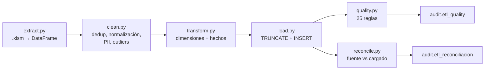

# 05. Proceso ETL, calidad y conciliación

## 1. Herramienta y justificación

**Python 3.12 + pandas + openpyxl + psycopg2**, empaquetado en Docker.

| Alternativa | Por qué no se eligió |
|---|---|
| Power Query | Excelente para Power BI, pero no deja el mismo artefacto ejecutable en Docker ni pruebas unitarias; el ETL quedaría acoplado a Windows/Power BI. |
| SQL + `COPY` | El `.xlsm` tiene formato ancho, celdas combinadas, typos y macros; la limpieza es más expresiva en pandas. |
| Talend / Airbyte | Sobredimensionado para 8 k filas y un archivo; añade infraestructura y licencias. |
| Scripts manuales | No serían reproducibles ni testeables. |

**Ventajas de la elección:** se ejecuta con `docker compose run --rm etl`, no
ejecuta macros, tiene pruebas (`pytest`), es idempotente (trunca y recarga en
una transacción) y deja bitácora de calidad/conciliación.

## 2. Arquitectura del ETL



**Orden de carga:** `dim_area` → `dim_maquina` → `dim_turno` →
`dim_referencia` → `dim_operario` → `dim_codigo_paro` →
`dim_subcodigo_paro` → `dim_personal` → `fact_produccion` → `fact_paro` →
`stg.registro_crudo`.

## 3. Reglas de limpieza aplicadas

| # | Regla | Implementación | Efecto |
|---|---|---|---|
| L1 | Normalizar nombres de columnas | `re.sub(r"\s+"," ", ...)` | Elimina saltos de línea del encabezado. |
| L2 | Deduplicar filas exactas | `drop_duplicates` sobre 58 columnas | 42 filas menos; diferencia documentada. |
| L3 | Parsear fecha | `pd.to_datetime` | 0 fechas inválidas. |
| L4 | Validar mes/año | Comparar `Mes`/`Año` contra `Fecha` | 0 inconsistencias; se usa la fecha como verdad. |
| L5 | Normalizar máquina | `strip()` + catálogo | 0 máquinas inválidas. |
| L6 | Normalizar turno | `normalize_shift` | 7 miembros canónicos; `SD` para vacío. |
| L7 | Normalizar referencia | `canonical_ref` + catálogo + reglas | 52 valores → 62 miembros (incluye catálogo y `SIN_REF`). |
| L8 | Unidades/paca | Catálogo o regla de formato | Cobertura 49,7 % de registros; 52,8 % de horas. |
| L9 | Seudonimizar personas | SHA-256 + sal + prefijo | 0 nombres reales en la base. |
| L10 | Redactar texto libre | Regex con nombres conocidos | `[PERSONA]` en observaciones. |
| L11 | Despivotar códigos | 18 columnas → filas | 16.482 eventos. |
| L12 | Normalizar subcódigos | `normalize_subcode` + mapping 4.x→5.x | 65 subcódigos; 0 estimados (todos mapearon al catálogo). |
| L13 | Mapear áreas | `normalize_area` | 5 áreas canónicas. |
| L14 | Marcar outliers | Capacidad ideal, horas > 16, pacas sin horas | 22 filas marcadas, conservadas. |
| L15 | Marcar incompletos | Pacas u horas faltantes | 3 filas, imputadas a 0. |
| L16 | Marcar paro sin producción | `(fecha, máquina)` sin registro de producción | 5 filas, 1,92 h. |
| L17 | Validar paro vs horas | `descuadre_paro` | 0 filas con diferencia > 0,01 h. |
| L18 | Marcar `Unidad por display` con turno | Regex `turno|am-|pm-` | 587 filas; no se usa como unidad. |

## 4. Conteos antes y después

| Concepto | Antes (bruto) | Después (dedup) | Diferencia | Explicación |
|---|---:|---:|---:|---|
| Filas | 8.208 | 8.166 | −42 | Duplicados exactos. |
| Registros de producción | 5.157 | 5.137 | −20 | 22 filas de producción duplicadas, pero 2 filas con horas y sin pacas se incorporan. |
| Eventos de paro | 16.532 | 16.482 | −50 | Los 42 duplicados contenían 50 eventos de paro. |
| Pacas | 378.778 | 377.759 | −1.019 | Duplicados. |
| Horas trabajadas | 38.063,35 | 37.934,35 | −129,00 | Duplicados. |
| Horas de paro | 8.449,65 | 8.431,54 | −18,12 | Duplicados. |

> La diferencia de filas de producción (5.157 → 5.137) no es −22 exacta porque
> el ETL incluye 2 filas con horas > 0 y pacas vacías (producción sin pacas
> registradas) y excluye 1 fila con horas = 0 y sin pacas. El detalle queda en
> `audit.etl_quality`.

## 5. Conciliación fuente → cargado

`audit.etl_reconciliacion` guarda una fila por métrica. Resultado de la última
corrida:

| Métrica | Fuente | Cargado | Diferencia | Concilia |
|---|---:|---:|---:|:---:|
| `filas_produccion` | 5.137 | 5.137 | 0 | ✅ |
| `pacas_producidas` | 377.759 | 377.759 | 0 | ✅ |
| `horas_trabajadas` | 37.934,35 | 37.934,35 | 0 | ✅ |
| `horas_paro` | 8.431,535 | 8.431,535 | 0 | ✅ |
| `eventos_paro` | 16.482 | 16.482 | 0 | ✅ |
| `tiempo_paro_vs_codigos` | 8.431,535 | 8.431,535 | 0 | ✅ |
| `pacas_brutas_vs_dedup` | 378.778 | 377.759 | −1.019 | ✅ (explicada) |
| `horas_brutas_vs_dedup` | 38.063,35 | 37.934,35 | −129,00 | ✅ (explicada) |
| `paro_bruto_vs_dedup` | 8.449,65 | 8.431,54 | −18,12 | ✅ (explicada) |

**Criterio:** las métricas críticas deben cumplir `|diferencia| ≤ 0,01`; si no,
el ETL falla y deja la corrida en `ERROR`. Las diferencias brutas se registran
como no críticas y con su explicación.

## 6. Reglas de calidad (`audit.etl_quality`)

La corrida registra 25 reglas. Las principales:

| Regla | Severidad esperada | Resultado |
|---|---|---|
| `duplicados_exactos` | WARN | 42 |
| `fechas_invalidas` | ERROR | 0 → INFO |
| `mes_inconsistente` / `anio_inconsistente` | ERROR | 0 → INFO |
| `maquinas_invalidas` | ERROR | 0 → INFO |
| `pacas_negativas` / `horas_negativas` | ERROR | 0 → INFO |
| `descuadre_tiempo_paro` | ERROR | 0 → INFO |
| `produccion_sin_referencia` | WARN | 2.586 (49,7 %) |
| `turno_sin_asignar` | WARN | 4.218 |
| `unidad_por_display_con_turno` | WARN | 587 |
| `paro_mayor_que_horas` | WARN | 45 |
| `paro_sin_produccion` | WARN | 5 (1,92 h) |
| `outliers_produccion` | WARN | 22 |
| `registros_incompletos` | WARN | 3 |
| `referencias_sin_unidades_por_paca` | WARN | 1 (`SIN_REF`) |
| `subcodigo_sin_especificar` | WARN | 12.898 (78,3 %) |
| `subcodigos_estimados` | INFO | 0 |
| `pii_seudonimos` | ERROR | 0 → INFO |
| `pii_hashes` | ERROR | 0 → INFO |
| `pii_nombres_en_staging` | ERROR | 0 → INFO |

Una regla con 0 filas afectadas se registra como `INFO` con prefijo `OK.` para
no confundir “no se encontró el problema” con “el problema está presente”.

## 7. Tratamiento de outliers

| Tipo | Criterio | Ejemplo | Acción |
|---|---|---|---|
| Pacas sobre capacidad | `pacas > 1,5 × horas × 60 × 72 / unidades_paca` | 9.417 pacas en 8 h sin referencia | `es_outlier=true`; no entra al rendimiento si no hay base. |
| Sin referencia y pacas > 1.000 | Regla conservadora | 5.184, 4.644… | Marca y conserva. |
| Horas > 16 | Turno imposible | 0 casos | Marca. |
| Pacas > 0 y horas = 0 | Sin base de tiempo | 1 caso | Marca; no calcula OEE. |
| Pacas u horas faltantes | `NaN` | 3 casos | Imputa 0 y `es_incompleto=true`. |

## 8. Cómo ejecutar y verificar

```bash
# Ejecutar
make etl

# Ver la última corrida
docker compose exec postgres psql -U oee_admin -d oee_bi -c \
  "SELECT * FROM audit.etl_run ORDER BY inicio DESC LIMIT 1;"

# Ver conciliación
docker compose exec postgres psql -U oee_admin -d oee_bi -c \
  "SELECT metrica, valor_fuente, valor_cargado, diferencia, concilia
   FROM audit.etl_reconciliacion ORDER BY id DESC LIMIT 20;"

# Ver reglas
docker compose exec postgres psql -U oee_admin -d oee_bi -c \
  "SELECT regla, severidad, filas_afectadas FROM audit.etl_quality
   ORDER BY severidad, regla;"
```

## 9. Idempotencia y recuperación

- El ETL trunca hechos y dimensiones (excepto `dim_tiempo`) y recarga en una
  sola transacción. Si algo falla, `ROLLBACK` deja la base como estaba.
- `TRUNCATE ... CASCADE` no reinicia identidades; `reset_sequences()` ajusta las
  secuencias después de la carga.
- La corrida se registra con `run_id` (UUID); calidad y conciliación quedan
  asociadas a ese `run_id`.
- El simulador se puede reiniciar con `python simulate_realtime.py --reset`.

## 10. Riesgos residuales

1. **Calidad no medida**: el OEE está incompleto por diseño de la fuente.
2. **Referencia faltante**: el OEE de 2022 no existe; 2023 es parcial.
3. **Estándar de 72 u/min**: si está mal calibrado, el rendimiento se distorsiona.
   Se conserva `rendimiento_calculado` para auditarlo.
4. **Texto libre**: la redacción cubre nombres conocidos, pero puede haber
   información sensible no catalogada; revisar antes de publicar.
5. **Zona horaria**: el simulador inserta UTC y la base está en America/Bogota;
   Grafana consulta con `NOW()`, por lo que la ventana es correcta, pero las
   visualizaciones deben usar la zona local.
