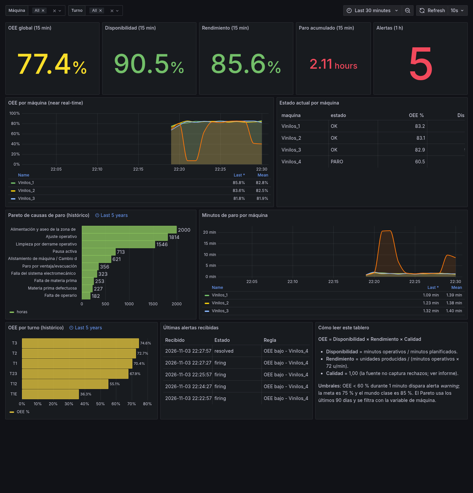
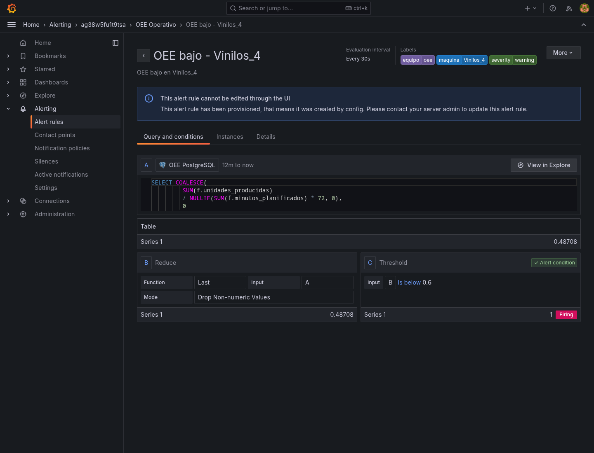
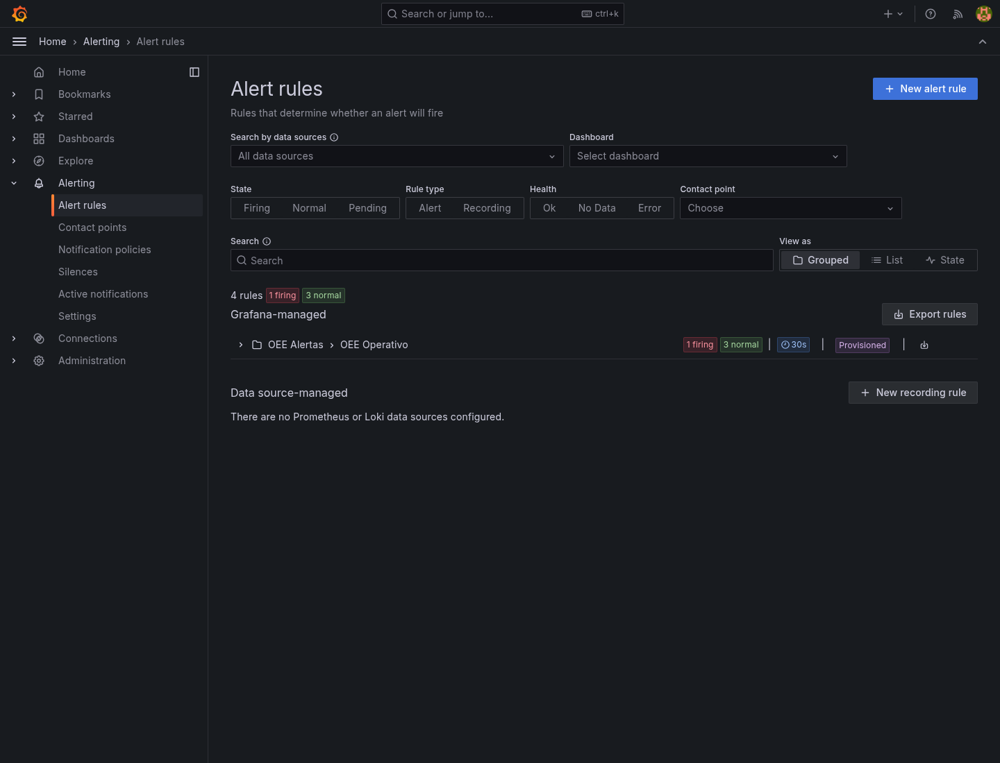

# 07. Tablero operativo en Grafana

## 1. Conexión y provisioning

- **Datasource**: PostgreSQL (`uid: oee-postgres`), URL `postgres:5432`, base
  `oee_bi`, usuario `oee_grafana` (solo lectura). La contraseña viene de
  `OEE_GRAFANA_PASSWORD` en `.env`; no está en el repositorio.
- **Provisioning**:
  - `grafana/provisioning/datasources/postgres.yml`
  - `grafana/provisioning/dashboards/dashboards.yml`
  - `grafana/provisioning/alerting/contact-points.yml`
  - `grafana/provisioning/alerting/notification-policies.yml`
  - `grafana/provisioning/alerting/rules.yml`
- **Dashboard exportado**: `grafana/dashboards/oee_operativo.json`
  (generado por `scripts/build_grafana_dashboard.py`).
- **UI**: `http://localhost:3000` → carpeta **OEE** → “OEE Envasado — Operación
  near real-time”.

## 2. Paneles

| Panel | Tipo | Consulta / fuente | Para qué |
|---|---|---|---|
| OEE global (15 min) | Stat | `fact_produccion_hora` | Ver la eficiencia actual. |
| Disponibilidad (15 min) | Stat | `fact_produccion_hora` | Minutos operativos / planificados. |
| Rendimiento (15 min) | Stat | `fact_produccion_hora` | Unidades / (minutos operativos × 72). |
| Paro acumulado (15 min) | Stat | `fact_produccion_hora` | Minutos de paro. |
| Alertas (1 h) | Stat | `vw_alertas_recientes` | Evidencia de alertas recibidas. |
| OEE por máquina | Time series | `vw_oee_hora` | Tendencia near real-time. |
| Estado actual por máquina | Table | `vw_estado_actual_maquina` | OK / ALERTA / PARO + OEE. |
| Pareto de causas | Bar chart | `fact_paro` + `dim_codigo_paro` | Últimos 5 años; causas que más pesan. |
| Minutos de paro por máquina | Time series | `vw_oee_hora` | Identificar la línea que se degrada. |
| OEE por turno | Bar chart | `vw_oee_turno` | Brecha entre turnos. |
| Últimas alertas | Table | `vw_alertas_recientes` | Firing / resolved con hora. |
| Cómo leer | Text | — | Fórmulas y umbrales. |

**Variables de tablero:**

- `maquina`: `SELECT codigo FROM oee.dim_maquina ORDER BY 1`, multivalor, “All”.
- `turno`: `SELECT codigo FROM oee.dim_turno WHERE es_valido ORDER BY 1`,
  multivalor, “All”.
- Rango de tiempo: por defecto **Last 30 minutes**; el Pareto y el turno tienen
  override a **Last 5 years** para incluir el histórico.

## 3. Regla de alerta

**Regla:** `OEE bajo - Vinilos_N` (4 reglas, una por máquina).
**Consulta:**

```sql
SELECT COALESCE(
         SUM(f.unidades_producidas)
         / NULLIF(SUM(f.minutos_planificados) * 72, 0),
         0
       ) AS oee
FROM oee.fact_produccion_hora f
JOIN oee.dim_maquina m ON m.maquina_key = f.maquina_key
WHERE m.codigo = 'Vinilos_4'
  AND f.ts_hora >= NOW() - INTERVAL '10 minutes';
```

**Condición:** `oee < 0,60` durante `1m` (`for: 1m`).
**Etiquetas:** `severity=warning`, `equipo=oee`, `maquina=Vinilos_N`.
**Contact point:** webhook `http://simulator:8080/alerts` → tabla
`audit.alertas_recibidas`.

**Justificación del umbral:** 85 % es clase mundial; 75 % es la meta interna;
60 % es el límite de control inferior (meta − 15 pp) y dispara intervención del
supervisor. En producción se recomienda `for: 5–10m` para evitar ruido; en la
demo se usa `1m` para que la reacción sea observable.

## 4. Simulación near real-time

`etl/simulate_realtime.py` inserta una fila por máquina cada 2 s en
`fact_produccion_hora`, representando 1 minuto simulado:

- **Normal:** paro 0–0,10 min, performance 78–98 % → OEE ~73–95 %.
- **Degradado:** paro 0,30–0,55 min, performance 35–60 % → OEE ~15–40 %.
- **Paro:** paro 0,55–0,85 min, performance 10–35 % → OEE ~3–14 %.
- Cada estado dura 40–80 ticks (80–160 s) para sostener la alerta.

**Comandos:**

```bash
# Simulación normal (con anomalías aleatorias)
make sim

# Forzar una anomalía en Vinilos_4 para demostrar la alerta
docker compose stop simulator
docker compose --profile sim run -d --service-ports --name oee-sim-force \
  simulator python simulate_realtime.py --serve-alerts \
  --force-anomaly --anomaly-machine Vinilos_4

# Ver la alerta
curl -u admin:... http://localhost:3000/api/prometheus/grafana/api/v1/rules
docker compose exec postgres psql -U oee_admin -d oee_bi \
  -c "SELECT * FROM audit.alertas_recibidas ORDER BY recibido_en DESC LIMIT 5;"

# Volver a la normalidad
docker stop oee-sim-force && docker rm oee-sim-force
docker compose --profile sim up -d simulator
```

## 5. Evidencias

### 5.1 Tablero operativo



### 5.2 Regla en estado *Firing*



La regla muestra el valor `0.48708` (< 0,60), la condición `Is below 0.6` y el
estado **Firing**.

### 5.3 Listado de reglas



## 6. Troubleshooting

| Síntoma | Causa probable | Solución |
|---|---|---|
| Paneles “No data” | El simulador no está corriendo o la ventana es 30 min. | `make sim`; revisar `fact_produccion_hora`. |
| “db query error: column maquina does not exist” | Dashboard viejo en caché. | Recargar con `?v=...` o reiniciar Grafana. |
| Alerta no dispara | OEE > 0,60 en la ventana de 10 min. | Forzar anomalía más tiempo o bajar el umbral. |
| Webhook no recibe | El simulador no está sirviendo `/alerts`. | `make sim`; verificar `http://localhost:8080/alerts`. |
| Datasource “Database Connection OK” falso | Contraseña incorrecta en `.env`. | Revisar `OEE_GRAFANA_PASSWORD`; `docker compose restart grafana`. |
