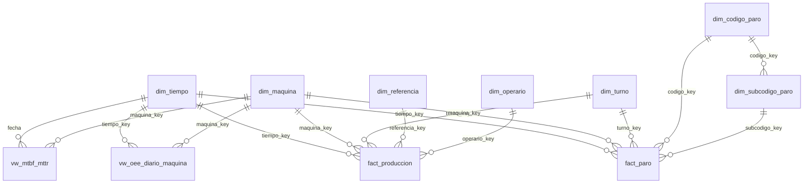
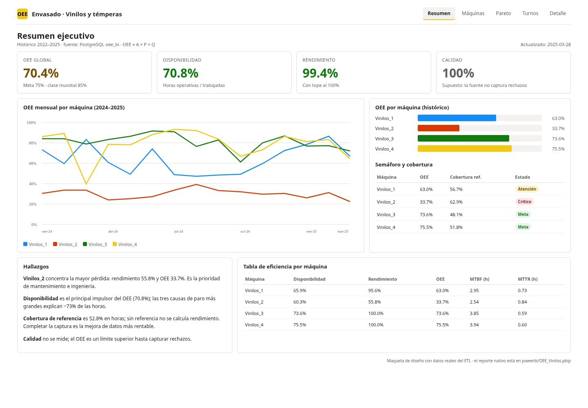
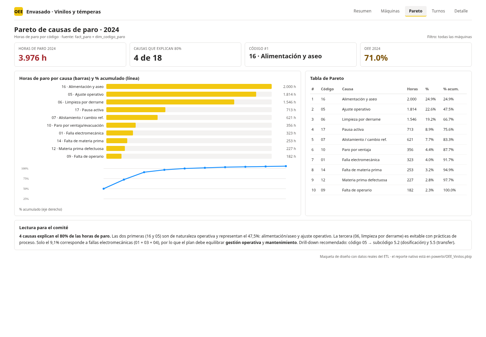

# 08. Tablero analítico en Power BI

## 1. Formato elegido: PBIP + PBIR (y `model.bim`)

Se versiona un **proyecto Power BI (PBIP)** con:

- Modelo semántico en **TMSL** (`OEE_Vinilos.SemanticModel/model.bim`), JSON
  legible y diffable.
- Reporte en **PBIR** (`OEE_Vinilos.Report/definition/`), con páginas y visuales
  en archivos JSON separados.
- Sin `.pbix` binario (ignorado en `.gitignore`).

**Justificación:** el `.pbix` es un ZIP binario que Git no puede diffear ni
fusionar; PBIP/PBIR permite revisar cambios en Pull Request, comparar medidas
DAX y reconstruir el reporte. El modelo TMSL es compatible con Power BI Desktop
y se puede abrir/refrescar contra PostgreSQL.

> Requiere Power BI Desktop actualizado (Windows) y, si la versión lo pide,
> habilitar **Vista previa de PBIP/PBIR** en *Opciones → Características de
> vista previa*.

## 2. Conexión a la base de datos

- Host: `localhost:5432` (ajustar si Power BI corre en otra máquina).
- Base: `oee_bi`.
- Usuario: `oee_bi` (solo lectura).
- Contraseña: `OEE_BI_PASSWORD` de `.env`; **no** se guarda en el PBIP.
- Modo: **Import** (histórico pequeño, refresco programado). Para near
  real-time se usa Grafana, no Power BI.

Para actualizar: *Inicio → Actualizar*. Si cambia el host, editar la expresión
M de cada partición (`PostgreSQL.Database("host:puerto","oee_bi")`).

## 3. Modelo semántico

### Tablas

| Tabla | Tipo | Grano / uso |
|---|---|---|
| `dim_tiempo` | Dimensión | Calendario; marcada como tabla de fechas. |
| `dim_maquina` | Dimensión | Líneas Vinilos_1..4. |
| `dim_turno` | Dimensión | Turnos normalizados. |
| `dim_referencia` | Dimensión SCD2 | Conversión unidades/paca. |
| `dim_operario` | Dimensión | Seudónimos. |
| `dim_codigo_paro` | Dimensión | Códigos 1..18. |
| `dim_subcodigo_paro` | Dimensión | Subcódigos; jerarquía. |
| `fact_produccion` | Hecho | Registros de producción. |
| `fact_paro` | Hecho | Eventos de paro. |
| `vw_oee_diario_maquina` | Hecho agregado | Día × máquina con A/P/Q/OEE. |
| `vw_mtbf_mttr` | Hecho agregado | Día × máquina con MTBF/MTTR. |
| `_Medidas` | Medidas | Tabla contenedora de DAX. |

### Relaciones



Todas las relaciones son **1:* con filtro en una dirección** (dimensión → hecho).
No hay relaciones many-to-many ni bidireccionales; evita ambigüedad y bucles.

## 4. Medidas DAX

```dax
OEE % =
VAR d = [Disponibilidad %]
VAR r = [Rendimiento %]
VAR c = [Calidad %]
RETURN d * MIN ( r, 1 ) * c

Disponibilidad % =
DIVIDE (
    SUM ( vw_oee_diario_maquina[horas_operativas_ref] ),
    SUM ( vw_oee_diario_maquina[horas_trabajadas_ref] )
)

Rendimiento % =
DIVIDE (
    SUM ( vw_oee_diario_maquina[unidades_producidas] ),
    SUM ( vw_oee_diario_maquina[minutos_ideales_operativos] )
)

Calidad % = 1

OEE YTD % =
TOTALYTD ( [OEE %], dim_tiempo[fecha] )

OEE Año Anterior % =
CALCULATE ( [OEE %], SAMEPERIODLASTYEAR ( dim_tiempo[fecha] ) )

Var OEE YoY pp = [OEE %] - [OEE Año Anterior %]

Var OEE YoY % =
DIVIDE ( [OEE %] - [OEE Año Anterior %], [OEE Año Anterior %] )

Horas Paro = SUM ( fact_paro[horas_paro] )
Eventos Paro = COUNTROWS ( fact_paro )

MTBF (h) =
DIVIDE ( SUM ( vw_mtbf_mttr[horas_operativas] ), SUM ( vw_mtbf_mttr[fallas] ) )

MTTR (h) =
DIVIDE ( SUM ( vw_mtbf_mttr[horas_paro_no_programado] ), SUM ( vw_mtbf_mttr[fallas] ) )

Cobertura Referencia % =
DIVIDE (
    SUM ( vw_oee_diario_maquina[horas_trabajadas_ref] ),
    SUM ( vw_oee_diario_maquina[horas_trabajadas] )
)

Pareto % Acumulado =
VAR actual = [Horas Paro]
VAR total = CALCULATE ( [Horas Paro], ALLSELECTED ( dim_codigo_paro ) )
VAR acum = CALCULATE (
    [Horas Paro],
    FILTER ( ALLSELECTED ( dim_codigo_paro ), [Horas Paro] >= actual )
)
RETURN DIVIDE ( acum, total )

Semáforo OEE =
SWITCH (
    TRUE (),
    [OEE %] >= 0.85, "🟢 Verde",
    [OEE %] >= 0.75, "🟡 Amarillo",
    [OEE %] >= 0.60, "🟠 Naranja",
    "🔴 Rojo"
)

OEE vs Meta pp = [OEE %] - 0.75
```

**Notas:**

- `MIN(r,1)` aplica el tope de rendimiento al 100 %; `rendimiento_calculado`
  queda disponible para diagnosticar el estándar.
- `Calidad % = 1` es una **limitación documentada**, no un dato real.
- `TOTALYTD` requiere que `dim_tiempo` esté marcada como tabla de fechas
  (`fecha` continua, sin huecos).
- El Pareto se calcula con `ALLSELECTED` para que funcione con los slicers.

## 5. Páginas y navegación

| Página | Contenido | Interacción |
|---|---|---|
| **1. Resumen ejecutivo** | Tarjetas OEE/A/P/Calidad, tendencia mensual por máquina, barras por máquina, texto narrativo. | Slicers de año/máquina. |
| **2. Análisis por máquina** | OEE YTD, tabla de A/P/OEE/MTBF/MTTR, cobertura de referencia. | Slicers de máquina y año; drill-down por mes. |
| **3. Pareto de paros** | Barras de horas por código, tabla con % acumulado, texto de drill-down/drill-through. | Slicers de máquina/año; clic derecho → Examinar. |
| **4. Turnos y referencias** | OEE por turno, tabla por referencia, cobertura. | Slicers. |
| **5. Detalle de paros** | Tabla fecha/máquina/turno/código/subcódigo/horas. | Página destino de drill-through. |

**Drill-down:** en la página 3, la tabla usa `dim_codigo_paro` y
`dim_subcodigo_paro`; el botón de expansión permite pasar de código a subcódigo.
**Drill-through:** desde una causa en la página 3, clic derecho → *Examinar* →
*Detalle de paros* (página 5). En Power BI Desktop, configurar la página 5 como
destino de drill-through con el campo `dim_codigo_paro[codigo]`.

## 6. Seguridad (RLS)

Roles definidos en `model.bim`:

| Rol | Filtro | Uso |
|---|---|---|
| `Supervisor_Vinilos_1` | `dim_maquina[codigo] = "Vinilos_1"` | Supervisor de línea. |
| `Supervisor_Vinilos_2` | `dim_maquina[codigo] = "Vinilos_2"` | Supervisor de línea. |
| `Supervisor_Vinilos_3` | `dim_maquina[codigo] = "Vinilos_3"` | Supervisor de línea. |
| `Supervisor_Vinilos_4` | `dim_maquina[codigo] = "Vinilos_4"` | Supervisor de línea. |
| `Gerencia` | Sin filtro | Alta dirección. |

El filtro en `dim_maquina` se propaga a los hechos por las relaciones 1:*.
Probar en *Modelado → Ver como rol*.

## 7. Actualización y publicación

1. Abrir `OEE_Vinilos.pbip` en Power BI Desktop.
2. *Inicio → Actualizar*; si pide credenciales, usar `oee_bi` y la contraseña de
   `.env`.
3. Validar que las tarjetas muestren OEE ~70 % y que la tabla de paros tenga
   datos.
4. Publicar en un workspace; asignar roles RLS a los usuarios/grupos.
5. Programar actualización (import) después del ETL (por ejemplo, 06:00 y 18:00).

## 8. Capturas

Las capturas nativas deben generarse en Power BI Desktop (Windows). En este
repositorio se incluye una **maqueta de diseño con datos reales** para el
informe:





> Reemplazar por capturas nativas al abrir el PBIP. La maqueta usa la misma
> narrativa visual y los datos calculados por el ETL.

## 9. Limitaciones

- Calidad = 100 % (fuente sin rechazos).
- OEE solo para registros con referencia; 2022 no tiene OEE.
- El PBIP generado programáticamente puede requerir ajustes menores de formato
  al abrirlo (posición de visuales, tema). El modelo y las medidas son el
  artefacto principal.
- La conexión usa `localhost`; cambiar el host si Power BI no corre en la misma
  máquina que Docker.
