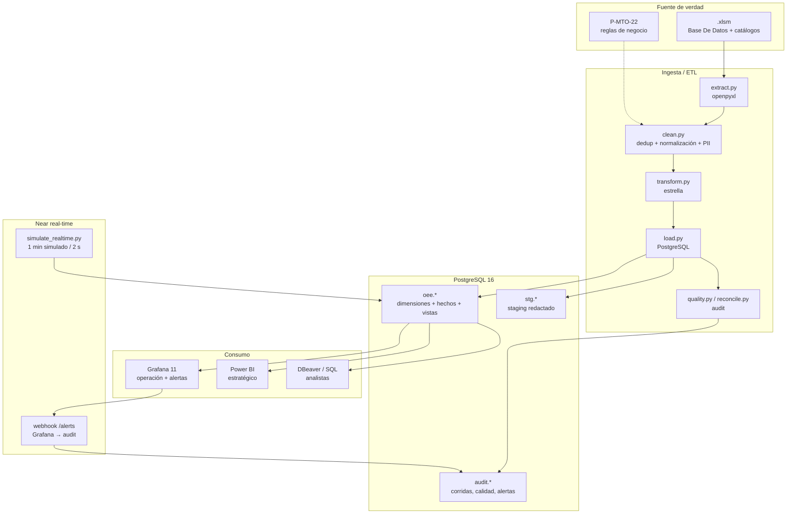

# 09. Arquitectura, gobierno y seguridad

## 1. Arquitectura completa

## 2. Grafana vs Power BI: no son intercambiables

| Dimensión | **Grafana** | **Power BI** |
|---|---|---|
| Pregunta que resuelve | ¿Cómo está la línea **ahora**? ¿Debo intervenir? | ¿Cuál es la **tendencia**? ¿Dónde invertir? |
| Usuario principal | Supervisor de línea, mantenimiento | Gerencia, jefatura de producción |
| Frecuencia | 10 s–1 min (near real-time) | Diaria / mensual (import) |
| Fuente | `fact_produccion_hora` + vistas | Modelo semántico importado de PostgreSQL |
| Fortaleza | Series temporales, estado, alertas, bajo coste | Modelo dimensional, DAX, narrativa, RLS, exportación |
| Debilidad | No es una herramienta de modelado semántico ni de storytelling | No está pensado para refresco subminuto ni alertas operativas |
| Alertas | Nativas (unified alerting) | No nativas; requiere Power Automate/Power BI alerts limitadas |
| Coste | Open source / self-hosted | Licencia Power BI Pro/Premium |
| Gobierno | Datasource + permisos de carpeta | Workspace + RLS + sensitivity labels |
| ¿Por qué no el otro? | Grafana no reemplaza un modelo semántico ni el DAX para el comité | Power BI no reemplaza el monitoreo continuo ni las alertas de planta |

**Conclusión:** son capas **complementarias**. Grafana responde “qué pasa ahora”;
Power BI responde “qué pasó, por qué y qué hacer”. El dato es el mismo
(PostgreSQL), pero el grano y la latencia son distintos.

## 3. Gobierno de datos

### 3.1 Datos personales (PII)

| Dato | Tratamiento | Dónde vive |
|---|---|---|
| Nombre de operaria | SHA-256 con sal + seudónimo `OP-xxxxxxxx` | `dim_operario` |
| Nombre de técnico | SHA-256 con sal + seudónimo `PM-xxxxxxxx` | `dim_personal` |
| Nombres en observaciones | Redacción con `[PERSONA]` | `fact_*`, `stg` |
| Nombre real | **No se carga**; solo en el `.xlsm` original | `data/raw` (ignorado) |

**Minimización:** solo se conserva el seudónimo y el hash; no se necesita el
nombre para el OEE. **Finalidad:** análisis de turnos y mantenimiento, no
evaluación individual. **Retención:** el histórico se conserva; el hash permite
reidentificar solo con la sal y el nombre original (custodiado por el área).

### 3.2 Seguridad de acceso

| Capa | Control |
|---|---|
| PostgreSQL | Roles `oee_etl` (RW), `oee_bi` (RO), `oee_grafana` (RO), `oee_admin` (DDL). |
| Esquemas | `audit` solo lectura para `oee_bi`; `stg` solo ETL. |
| Grafana | Autenticación propia; datasource con `oee_grafana`; permisos por carpeta/dashboard. |
| Power BI | RLS `Supervisor_Vinilos_1..4` y `Gerencia`; workspace con grupos de seguridad. |
| Secretos | `.env` (600), `.env.example` sin valores reales; nunca en Git. |
| Red | PostgreSQL y Grafana expuestos en localhost; en producción, detrás de reverse proxy/TLS. |
| Auditoría | `audit.etl_run`, `etl_quality`, `etl_reconciliacion`, `alertas_recibidas`. |

### 3.3 Calidad y linaje

- Cada hecho guarda `origen_fila` (y `origen_columna` en paros) → se puede
  rastrear hasta la fila del Excel.
- `stg.registro_crudo` guarda el payload redactado y el hash.
- `audit.etl_quality` documenta 25 reglas con conteos.
- `audit.etl_reconciliacion` demuestra que los totales concilian.

## 4. Operación y respaldo

| Tema | Práctica |
|---|---|
| Backup | `pg_dump` diario del esquema `oee` + `audit`; retención 30 días. |
| Recuperación | `make reset` reconstruye desde cero; el ETL es idempotente. |
| Monitorización | Healthcheck de Postgres; logs de Grafana; alerta si el ETL falla. |
| Actualización | ETL programado (cron/Airflow) antes del refresco de Power BI. |
| Cambios de esquema | Migraciones versionadas en `db/init`; para cambios grandes, `db/migrations/`. |
| Capacidad | 8 k filas históricas; PostgreSQL cabe en 1 GB. Escalar con particiones/vistas materializadas. |

## 5. Riesgos y mitigaciones

| Riesgo | Impacto | Mitigación |
|---|---|---|
| Calidad no medida | OEE sobreestimado | Capturar rechazos; mientras tanto, reportar `Calidad=100 %` explícitamente. |
| Referencia faltante | OEE no calculable | Cobertura visible; completar referencia en la captura. |
| Estándar 72 u/min mal calibrado | Rendimiento distorsionado | `rendimiento_calculado` y Pareto de sobre-rendimiento; recalibrar con ingeniería. |
| Nombres en texto libre | PII residual | Redacción automática + revisión manual antes de publicar. |
| Alertas ruidosas | Fatiga de alertas | `for: 5–10m` en producción; histéresis y agrupación. |
| Zona horaria | Ventanas incorrectas | Guardar `timestamptz`; Grafana y Postgres en America/Bogota. |
| Dependencia de un solo Excel | Pérdida de fuente | Backup del `.xlsm`; migrar a formulario/BD. |
| Power BI en Windows | No reproducible en Linux | PBIP/PBIR versionado; capturas nativas en Windows; Grafana cubre la operación. |

## 6. Cumplimiento del requerimiento de seguridad

- [x] Datos personales seudonimizados y minimizados.
- [x] Roles de mínimo privilegio en PostgreSQL.
- [x] RLS en Power BI por línea.
- [x] Grafana con autenticación y datasource de solo lectura.
- [x] Secretos fuera del repositorio (`.env.example`).
- [x] Auditoría de cargas, calidad y alertas.
- [x] Sin credenciales en cadenas de conexión versionadas.
