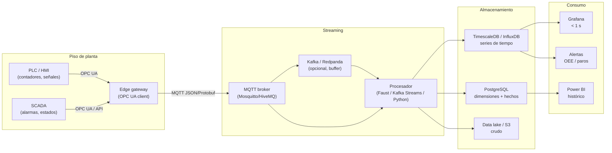

# 10. Evolución si los datos llegaran desde PLC / SCADA

## 1. Punto de partida

Hoy el dato nace en papel (“hora a hora”), se transcribe a Excel y se carga por
lote. La latencia es de días/semanas y la calidad depende de la digitación. Si
las líneas se instrumentan, el OEE puede pasar de **batch** a **streaming** sin
cambiar el modelo dimensional: cambia la ingesta y la granularidad.

## 2. Arquitectura objetivo



## 3. Cambios por capa

| Capa | Hoy | Con PLC/SCADA |
|---|---|---|
| Captura | Papel + Excel | Señales del PLC (contador de unidades, estado de máquina, alarma) + operario en HMI. |
| Frecuencia | Día | Segundo / minuto. |
| Transporte | Archivo | OPC UA → MQTT → procesador. |
| Almacenamiento | PostgreSQL | PostgreSQL para dimensiones/hechos + TimescaleDB/InfluxDB para series. |
| ETL | Batch Python | Streaming (Faust/Kafka Streams) + micro-batch para dimensiones. |
| Calidad | Reglas batch | Validación en streaming (rangos, staleness, duplicados por `event_id`). |
| OEE | Calculado por día | Calculado por minuto/turno; ventanas móviles. |
| Alertas | Grafana cada 30 s | Grafana/Alertmanager en < 10 s; reglas por máquina y por turno. |
| Gobierno | Seudonimización batch | Seudonimización en el edge; minimización en origen. |

## 4. Modelo de datos propuesto

1. **Mantener** `dim_tiempo`, `dim_maquina`, `dim_turno`, `dim_referencia`,
   `dim_codigo_paro`, `dim_subcodigo_paro`.
2. **Añadir** una tabla de hechos de alta frecuencia:
   ```sql
   fact_evento_plc (
     evento_id uuid,
     ts timestamptz,
     maquina_key smallint,
     turno_key smallint,
     referencia_key integer,
     estado varchar(20),        -- RUN, STOP, IDLE, FAULT
     contador_unidades bigint,
     velocidad_unidades_min numeric,
     codigo_paro_key smallint,
     origen varchar(20)         -- OPCUA, MQTT, HMI
   )
   ```
3. **TimescaleDB**: hypertable por `ts`, compresión por chunks, retención de
   90 días en caliente y agregados continuos (`oee_1m`, `oee_1h`).
4. **Idempotencia**: `evento_id` único; deduplicación en el procesador.
5. **Calidad**: reglas de staleness (si no llega dato en 60 s → `NO_DATA`),
   rangos físicos (velocidad ≤ capacidad), y reconciliación de contadores.

## 5. Cambios en los KPIs

- OEE por minuto y por turno en tiempo real.
- **Microparos**: eventos < 5 min que hoy no se registran; el PLC los captura.
- **Velocidad real vs ideal** por referencia; mejor calibración del rendimiento.
- **Calidad** si se integra un sensor/visor de rechazos.
- **MTBF/MTTR** automáticos a partir de transiciones `RUN → FAULT → RUN`.
- **Pareto** por código/subcódigo con hora exacta, no solo día.

## 6. Fases de implementación

| Fase | Alcance | Entregable | Riesgo |
|---|---|---|---|
| 0 | Piloto en una línea | Gateway OPC UA + MQTT + TimescaleDB | Conectividad y permisos de red. |
| 1 | Modelo de eventos y OEE por minuto | `fact_evento_plc` + vistas | Semántica de estados del PLC. |
| 2 | Alertas y microparos | Reglas Grafana/Alertmanager | Fatiga de alertas. |
| 3 | Calidad y rechazos | Sensor/visor + `unidades_buenas` | Integración con calidad. |
| 4 | Todas las líneas | Despliegue y capacitación | Cambio cultural. |

## 7. Riesgos y consideraciones

- **Ciberseguridad OT/IT**: segmentar la red; OPC UA con certificados; no exponer
  PLC a Internet; mínimo privilegio.
- **Relojes**: sincronizar NTP en PLC, edge y servidores; usar `timestamptz`.
- **Pérdida de conectividad**: buffer local en el edge (store-and-forward).
- **Calidad del dato**: los contadores del PLC pueden reiniciarse; validar
  monotonía y usar deltas.
- **Gobierno**: los datos de operario siguen siendo PII; el edge debe
  seudonimizar antes de transmitir.
- **Coste**: licencias de SCADA, gateways, broker y almacenamiento; evaluar
  retorno con la reducción de paros.

## 8. Qué no cambia

- El **modelo dimensional** y las dimensiones conformadas.
- La **definición de OEE** (A × P × Q) y los umbrales.
- El **tablero de Power BI** (puede seguir en import para el comité).
- La **seguridad y el gobierno** (roles, RLS, seudonimización).
- El **Pareto**: solo gana granularidad y latencia.

En resumen: la solución actual es la base analítica; PLC/SCADA cambia la
**ingesta** y la **frecuencia**, no la semántica del negocio.
