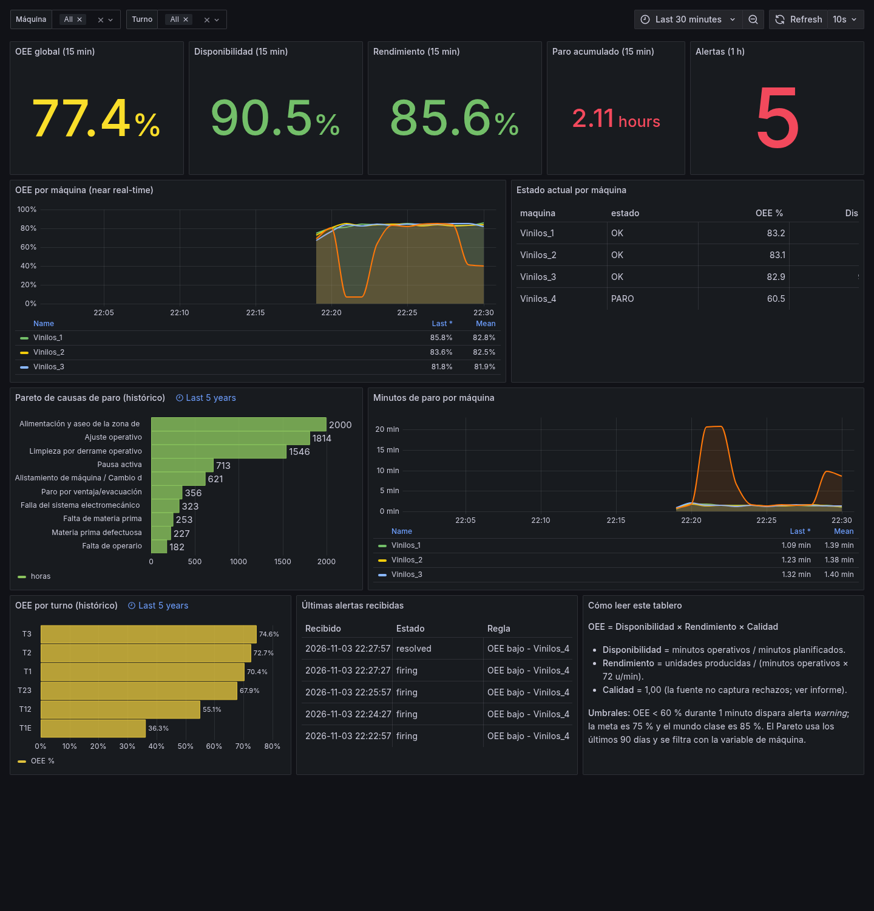
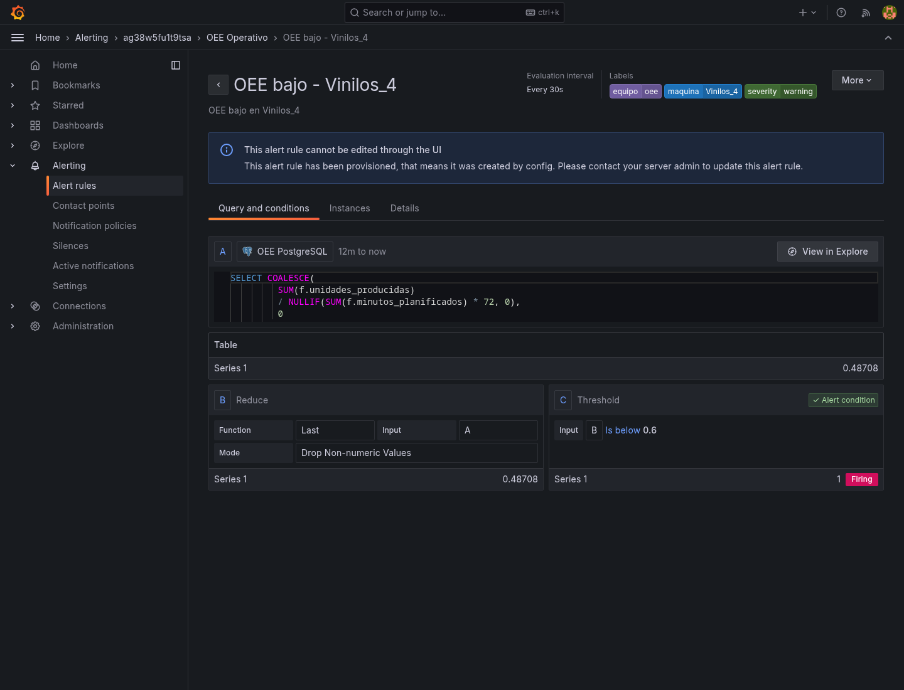
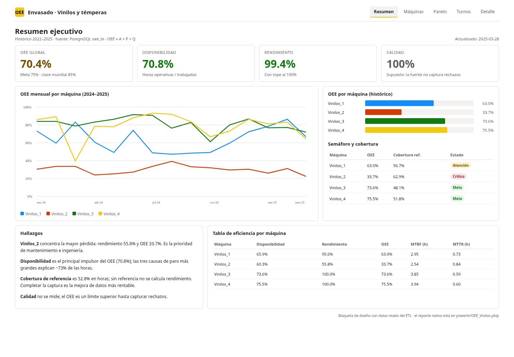
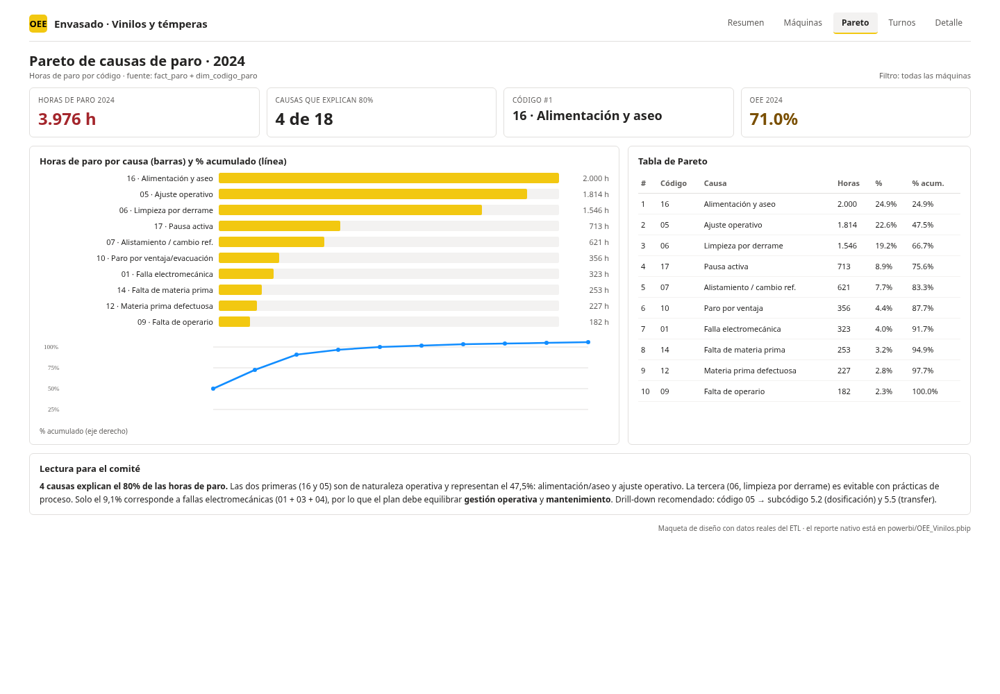
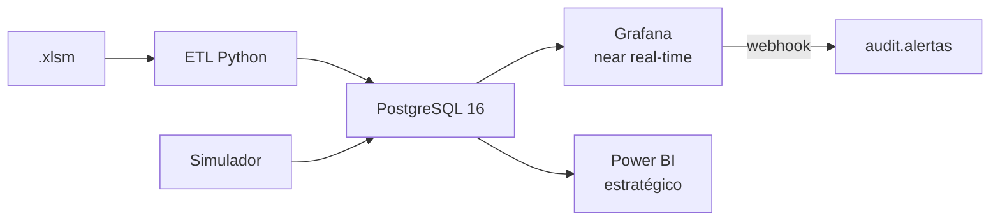

# Informe final — Solución de BI end-to-end para OEE en líneas de envasado

<div align="center">

## OEE Envasado — Vinilos y témperas

**Taller 5 · Inteligencia de Negocios**

| | |
|---|---|
| **Integrantes** | _Completar nombre 1_ <br> _Completar nombre 2_ <br> _Completar nombre 3_ |
| **Repositorio** | `https://github.com/<usuario>/oee-envasado-bi` _(reemplazar al publicar)_ |
| **Fecha** | Noviembre de 2026 |
| **Fuente** | `SEGUIMIENTO TEMPERAS Y VINILOS Actividad.xlsm` + P-MTO-22 |
| **Stack** | PostgreSQL 16 · Python/pandas · Docker Compose · Grafana 11 · Power BI (PBIP/PBIR) |

</div>

---

## Resumen ejecutivo

Se diseñó e implementó una solución de BI **end-to-end y contenerizada** para las
cuatro líneas de envasado. El ETL procesa **8.208 filas** históricas (2022-01 a
2025-03), detecta **42 duplicados exactos**, normaliza turnos, referencias,
códigos y subcódigos, seudonimiza a las personas y carga un **modelo en
constelación** en PostgreSQL. Los totales **concilian al 100 %** después de
deduplicar (377.759 pacas, 37.934,35 horas trabajadas, 8.431,535 horas de paro).

La solución habilita dos capas complementarias:

- **Grafana**: tablero operativo near real-time, variables por máquina/turno,
  estado por máquina y **alerta de OEE < 60 %** con webhook local.
- **Power BI**: modelo semántico con DAX, inteligencia de tiempo (YTD, año
  anterior), Pareto, páginas con slicers y RLS por línea.

**Resultados principales:**

| Indicador | Valor |
|---|---:|
| OEE 2024 | **71,0 %** |
| OEE 2025 (ene–mar) | **70,2 %** |
| Mejor línea (OEE histórico) | **Vinilos_4: 75,5 %** |
| Peor línea (OEE histórico) | **Vinilos_2: 33,7 %** |
| Causas que concentran ~73 % de las horas de paro | **16, 5 y 6** |
| MTBF / MTTR histórico | **2,5–3,9 h / 0,6–0,84 h** |
| Cobertura de referencia | **52,8 % de las horas** |

**Conclusión:** la línea **Vinilos_2** es la prioridad (rendimiento 55,8 %); las
mayores pérdidas son operativas (alimentación/aseo, ajuste operativo, limpieza
por derrame), no solo fallas mecánicas. La calidad no se puede medir con la
fuente actual: el OEE es un **límite superior** hasta que se capturen rechazos.

---

## 1. Contexto y diagnóstico

### 1.1 Stakeholders y preguntas

| Stakeholder | Pregunta principal |
|---|---|
| Alta dirección | ¿Cómo evoluciona el OEE y dónde invertir? |
| Jefatura de Producción | ¿Qué turno/referencia limita el plan? |
| Coordinación de Mantenimiento | ¿Cuáles son las causas raíz y el MTBF/MTTR? |
| Supervisores | ¿Cómo está la línea ahora y debo intervenir? |
| Calidad | ¿Cuánto tiempo se pierde por materia prima/laboratorio? |
| TI / Datos | ¿El ETL concilia y es seguro? |

### 1.2 La fuente

El `.xlsm` tiene una hoja `Base De Datos` en formato **ancho**: 58 columnas y
8.208 filas. Cada fila puede contener producción y hasta 18 códigos de paro.
Hallazgos clave:

- La columna `Codigo de paro N` contiene **minutos**, no el código; el código
  está implícito en la posición N. El ETL lo despivota correctamente.
- `Tiempo de Paro` = suma de los 18 pares código/horas en el **100 %** de las
  filas.
- **42 duplicados exactos**, 3.051 filas hijas sin producción, 49,7 % de
  registros sin referencia, 51,4 % sin turno, 78,3 % de eventos sin subcódigo.
- `Unidad por display` contiene turnos en 587 filas; `Horas no trabajadas` es un
  dato de día con semántica inconsistente; `Tipo de paro` usa una numeración
  heredada (1–19).
- No hay datos de rechazo/calidad.

El detalle completo está en [`documentacion/01_diagnostico.md`](../documentacion/01_diagnostico.md).

---

## 2. Requerimientos y catálogo de KPIs

Se conservan los indicadores que reporta hoy el P-MTO-22 (producción general,
por máquina, por referencia, horas, % de códigos y análisis 01/03/05) y se
proponen 15 KPIs nuevos. Los principales:

| KPI | Fórmula | Unidad | Meta / alerta | Usuario |
|---|---|---|---:|---|
| **OEE** | A × P × Q | % | 75 % / < 60 % | Gerencia |
| **Disponibilidad** | (horas trabajadas − paro) / horas trabajadas | % | 85 % / < 70 % | Producción |
| **Rendimiento** | unidades / (minutos operativos × 72) | % | 90 % / < 75 % | Producción |
| **Calidad** | unidades buenas / producidas | % | 99 % / < 97 % | Calidad |
| **MTBF** | horas operativas / fallas no programadas | h | ≥ 4 h / < 2 h | Mantenimiento |
| **MTTR** | horas de paro no programado / fallas | h | ≤ 0,75 h / > 1 h | Mantenimiento |
| **Pareto** | horas por causa y % acumulado | h / % | 80 % en ≤ 20 % causas | Gerencia |
| **Cobertura de referencia** | horas con referencia / horas totales | % | ≥ 90 % / < 70 % | TI |

El catálogo completo, con granularidad, fuente y justificación, está en
[`documentacion/02_requerimientos_kpis.md`](../documentacion/02_requerimientos_kpis.md).

**Umbral de la alerta:** OEE < 60 % durante 1 minuto. Se justifica como
**límite de control inferior** (meta 75 % − 15 pp); 85 % es clase mundial. En
producción se recomienda 5–10 min para evitar fatiga de alertas.

---

## 3. Modelo dimensional

### 3.1 Constelación y grano

Se usa un **esquema en constelación** con dos hechos que comparten dimensiones
conformadas. No se unen producción y paros en una sola tabla porque una fila de
producción puede tener 0..18 paros y una fila hija de paro puede no tener
producción; unirlas duplicaría pacas/horas.

| Tabla | Grano |
|---|---|
| `fact_produccion` | Un registro de producción (fila con pacas u horas, tras deduplicar). |
| `fact_paro` | Un evento de paro (fila × columna de código 1..18 con minutos > 0). |
| `fact_produccion_hora` | Un minuto simulado × máquina (near real-time). |
| `vw_oee_diario_maquina` | Día × máquina. |
| `vw_oee_mensual_maquina` | Mes × máquina. |
| `vw_oee_turno` | Mes × turno. |
| `vw_pareto_paros` | Mes × máquina × código × subcódigo. |
| `vw_mtbf_mttr` | Día × máquina. |

### 3.2 Dimensiones y jerarquías

- `dim_tiempo` (construida): año → trimestre → mes → día; semana ISO; fin de semana.
- `dim_maquina`: 4 líneas.
- `dim_turno` (construida): T1, T2, T3, T1E, T12, T23, SD.
- `dim_referencia` (**SCD Tipo 2**): unidades/paca y velocidad ideal versionadas.
- `dim_operario` / `dim_personal`: seudónimos.
- `dim_codigo_paro` → `dim_subcodigo_paro`: jerarquía código → subcódigo →
  sub-subcódigo (`nivel`, `subcodigo_padre`, `ruta`).

**SCD Tipo 2 en `dim_referencia`:** la conversión unidades/paca puede cambiar con
el empaque; el OEE histórico debe usar la versión vigente. Un Tipo 1 borraría la
historia; un Tipo 3 no escala a más de dos versiones.

### 3.3 Matriz de bus

| Proceso | Tiempo | Máquina | Turno | Referencia | Operario | Código | Subcódigo | Área | Personal |
|---|:---:|:---:|:---:|:---:|:---:|:---:|:---:|:---:|:---:|
| Producción | X | X | X | X | X |  |  |  |  |
| Paros | X | X | X | X | X | X | X | X | X |
| OEE diario | X | X |  |  |  |  |  |  |  |
| OEE turno | X | X | X |  |  |  |  |  |  |
| Pareto | X | X |  |  |  | X | X |  |  |
| MTBF/MTTR | X | X |  |  |  |  |  |  |  |
| Near real-time | X | X | X | X |  |  |  |  |  |

Detalle y diagrama ER en [`documentacion/03_modelo_dimensional.md`](../documentacion/03_modelo_dimensional.md).

---

## 4. Diccionario de datos y lineage

Cada tabla tiene descripción, columnas, tipos, PK/FK, regla de transformación y
origen. Ejemplos:

| Destino | Origen | Regla |
|---|---|---|
| `fact_produccion.pacas_producidas` | `Pacas producidas` | Numérico; imputa 0 si falta; marca `es_incompleto`. |
| `fact_produccion.unidades_producidas` | `pacas × unidades_por_paca` | Nulo si no hay referencia. |
| `fact_paro.minutos_paro` | `Codigo de paro N` | **Es minutos**, no código; se despivota. |
| `fact_paro.horas_paro` | `Codigo N en horas` | Si falta, `minutos/60`. |
| `dim_operario.seudonimo` | `Operario` | `OP-` + SHA-256(salt+nombre)[:8]. |
| `dim_referencia.unidades_por_paca` | Catálogo / regla de formato | 600 para 6 col 22cc, 45 para 125cc, etc. |
| `dim_tiempo` | `generate_series` | Calendario 2021–2027. |

El diccionario completo está en
[`documentacion/04_diccionario_datos.md`](../documentacion/04_diccionario_datos.md).

---

## 5. ETL, calidad y conciliación

### 5.1 Herramienta

Python 3.12 + pandas + openpyxl + psycopg2, en Docker. Se eligió por
reproducibilidad, pruebas unitarias, lectura de `.xlsm` sin macros y despliegue
con un solo comando. Alternativas (Power Query, Talend, scripts manuales) se
descartaron por acoplamiento a Windows, sobredimensionamiento o falta de
reproducibilidad.

### 5.2 Reglas y conteos

| Concepto | Bruto | Después de dedup | Diferencia |
|---|---:|---:|---:|
| Filas | 8.208 | 8.166 | −42 |
| Registros de producción | 5.157 | 5.137 | −20 |
| Eventos de paro | 16.532 | 16.482 | −50 |
| Pacas | 378.778 | 377.759 | −1.019 |
| Horas trabajadas | 38.063,35 | 37.934,35 | −129,00 |
| Horas de paro | 8.449,65 | 8.431,54 | −18,12 |

Las diferencias brutas corresponden **exactamente** a los 42 duplicados
(1.019 pacas, 129 h, 18,12 h). La conciliación crítica (fuente dedup vs cargado)
da **0** en todas las métricas. El ETL falla si alguna métrica crítica supera
0,01 de tolerancia.

### 5.3 Reglas de calidad

25 reglas en `audit.etl_quality`: duplicados, fechas, máquinas, negativos,
descuadre de paro, cobertura de referencia, turno, subcódigo, outliers,
incompletos, PII, etc. Las reglas con 0 afectadas se registran como `INFO` con
prefijo `OK.`; las que sí tienen hallazgos quedan como `WARN` (10 en la última
corrida).

### 5.4 PII

Los nombres se seudonimizan con SHA-256 + sal; el texto libre se redacta con
`[PERSONA]`. La validación `pii_nombres_en_staging` da 0. El nombre real solo
existe en `data/raw` (ignorado).

Detalle en [`documentacion/05_etl_calidad.md`](../documentacion/05_etl_calidad.md).

---

## 6. Base de datos y consultas SQL

- PostgreSQL 16, esquemas `oee`, `stg`, `audit`.
- DDL con PK/FK/CHECK/UNIQUE e índices para los patrones de consulta
  (fecha, máquina+fecha, código, subcódigo, timestamp).
- 12 consultas analíticas en `db/queries/` con `RANK`, `LAG`, `SUM() OVER`,
  `AVG() OVER`, `ROW_NUMBER`, `FILTER`, `ROLLUP`/`UNION ALL`.
- Ejemplos: OEE mensual con YTD, ranking de máquinas, Pareto acumulado, top 5
  causas por máquina, 2024 vs 2025, MTBF/MTTR, turnos, drill-down de
  subcódigos, media móvil 7/30 días, calidad/conciliación, heatmap y OEE por
  referencia.

Ver [`documentacion/06_consultas_sql.md`](../documentacion/06_consultas_sql.md).

---

## 7. Tablero operativo en Grafana

### 7.1 Paneles y variables

- 5 stat panels: OEE, disponibilidad, rendimiento, paro acumulado y alertas.
- Serie temporal de OEE por máquina, estado actual por máquina, Pareto,
  minutos de paro, OEE por turno y últimas alertas.
- Variables `maquina` y `turno` (multivalor, All).
- Rango por defecto: últimos 30 minutos; Pareto/turno con override a 5 años.

### 7.2 Alerta y simulación

- 4 reglas (una por máquina): `OEE < 0,60` durante `1m`.
- Contact point webhook → `audit.alertas_recibidas`.
- Simulador: 1 minuto simulado cada 2 s; modos normal/degradado/paro;
  anomalía forzable por máquina.

### 7.3 Evidencias





La regla muestra `0.48708 < 0.6` y estado **Firing**; el tablero muestra la
caída de Vinilos_4 y la tabla de alertas con `firing`/`resolved`.

Ver [`documentacion/07_grafana.md`](../documentacion/07_grafana.md).

---

## 8. Tablero analítico en Power BI

### 8.1 Formato y conexión

- **PBIP + PBIR + `model.bim` (TMSL)**, sin `.pbix` binario.
- Conexión a PostgreSQL (`localhost:5432`, `oee_bi`, usuario `oee_bi`), modo
  Import. Credenciales fuera del proyecto.
- Modelo con 7 dimensiones, 2 hechos, 2 vistas agregadas y tabla `_Medidas`.

### 8.2 Medidas DAX

`OEE %`, `Disponibilidad %`, `Rendimiento %`, `Calidad %`, `OEE YTD %`,
`OEE Año Anterior %`, `Var OEE YoY pp/%`, `Horas Paro`, `Eventos Paro`,
`MTBF (h)`, `MTTR (h)`, `Cobertura Referencia %`, `Pareto % Acumulado`,
`Semáforo OEE`, `OEE vs Meta pp`.

La inteligencia de tiempo se apoya en `dim_tiempo` marcada como tabla de fechas
y `TOTALYTD` / `SAMEPERIODLASTYEAR`.

### 8.3 Páginas, slicers y drill

1. Resumen ejecutivo.
2. Análisis por máquina.
3. Pareto de paros (drill-down código → subcódigo; drill-through a detalle).
4. Turnos y referencias.
5. Detalle de paros.

### 8.4 RLS

Roles `Supervisor_Vinilos_1..4` con filtro en `dim_maquina[codigo]` y
`Gerencia` sin filtro. El filtro se propaga a los hechos.

### 8.5 Capturas (maqueta de diseño con datos reales)





> Las capturas nativas deben generarse al abrir `powerbi/OEE_Vinilos.pbip` en
> Power BI Desktop (Windows). La maqueta usa la misma narrativa y los datos del
> ETL.

Ver [`documentacion/08_powerbi.md`](../documentacion/08_powerbi.md).

---

## 9. Arquitectura y comparativo Grafana vs Power BI



| Dimensión | Grafana | Power BI |
|---|---|---|
| Pregunta | ¿Qué pasa ahora? | ¿Qué pasó y por qué? |
| Usuario | Supervisor, mantenimiento | Gerencia, jefatura |
| Frecuencia | 10 s–1 min | Diaria/mensual |
| Fortaleza | Series, estado, alertas | Modelo, DAX, RLS, narrativa |
| ¿Intercambiables? | **No** | **No** |

**Por qué no son intercambiables:** Grafana no ofrece un modelo semántico ni DAX
para el comité; Power BI no está diseñado para refresco subminuto ni alertas
operativas nativas. Se complementan sobre el mismo dato.

Ver [`documentacion/09_arquitectura_seguridad.md`](../documentacion/09_arquitectura_seguridad.md).

---

## 10. Gobierno y seguridad

- **PII**: seudonimización SHA-256 + sal; sin nombres reales en la base; texto
  libre redactado.
- **Roles PostgreSQL**: `oee_etl` (RW), `oee_bi` (RO), `oee_grafana` (RO),
  `oee_admin` (DDL).
- **Power BI RLS** por línea; **Grafana** autenticación y datasource de solo
  lectura.
- **Secretos**: `.env` (600) + `.env.example`; `.gitignore` excluye `docs/`,
  `data/raw`, `.env`, `.pbix`.
- **Auditoría**: `etl_run`, `etl_quality`, `etl_reconciliacion`,
  `alertas_recibidas`.

---

## 11. Evolución a PLC / SCADA

Si el dato llega de PLC/SCADA, se mantiene el modelo dimensional y cambia la
ingesta:

- **OPC UA** en el edge → **MQTT** → procesador (Faust/Kafka Streams).
- **TimescaleDB/InfluxDB** para series; PostgreSQL para dimensiones/hechos.
- OEE por minuto, microparos, velocidad real vs ideal y calidad si se integra
  un sensor de rechazos.
- Alertas en < 10 s; retención caliente 90 días y agregados continuos.
- Riesgos: ciberseguridad OT/IT, relojes/NTP, buffer store-and-forward,
  reinicio de contadores.

Ver [`documentacion/10_evolucion_scada.md`](../documentacion/10_evolucion_scada.md).

---

## 12. Repositorio y reproducción

```bash
cp .env.example .env          # cambiar credenciales y PII_SALT
mkdir -p data/raw             # copiar el .xlsm y el PDF
make up                       # PostgreSQL + Grafana
make etl                      # carga + calidad + conciliación
make sim                      # simulador + webhook
make test                     # 7 pruebas unitarias
```

Estructura, comandos y troubleshooting en [`README.md`](../README.md).

**Git:** el repositorio incluye commits por fase (diagnóstico, modelo, DDL, ETL,
Grafana, Power BI, docs). `docs/`, `data/raw/`, `.env` y `.pbix` están ignorados.

---

## 13. Conclusiones y recomendaciones

1. **Priorizar Vinilos_2**: su OEE (33,7 %) está muy por debajo del resto;
   el rendimiento (55,8 %) es el principal cuello de botella. Revisar el estándar
   de 72 u/min y la dosificación/transfer.
2. **Atacar las causas operativas**: 16 (alimentación/aseo), 5 (ajuste) y 6
   (limpieza) explican ~73 % de las horas. Un plan de 5S/estándar de ajuste
   puede mover el OEE más que el mantenimiento correctivo.
3. **Completar la captura de referencia y turno**: sin referencia no hay OEE
   (cobertura 52,8 % en horas). Es la mejora de datos con mayor retorno.
4. **Capturar rechazos**: el OEE actual es un límite superior (Calidad = 100 %).
   Añadir `unidades_rechazadas` al formato P-MTO-22.
5. **Calibrar el estándar**: 58 % de las observaciones superan 100 % de
   rendimiento; el estándar de 72 u/min o la conversión unidades/paca están
   subestimados. Usar `rendimiento_calculado` y un estudio de tiempos.
6. **Sostener la disciplina de calidad**: 42 duplicados y 3.051 filas hijas
   evidencian la necesidad de validaciones en la captura (formulario/HMI).

---

## 14. Checklist de cumplimiento (sección 5)

### 5.1 Análisis y requerimientos
- [x] Stakeholders y preguntas de negocio.
- [x] Diagnóstico de la fuente, calidad y limitaciones.

### 5.2 KPIs
- [x] Catálogo con fórmula, unidad, granularidad, meta, fuente y usuario.
- [x] Indicadores actuales del P-MTO-22.
- [x] KPIs nuevos justificados (OEE, A/P/Q, MTBF, MTTR, Pareto, cobertura).

### 5.3 Modelado dimensional
- [x] Estrella/constelación justificada.
- [x] Grano declarado por tabla.
- [x] Dimensiones, atributos y jerarquías; dimensión construida (`dim_tiempo`).
- [x] Jerarquía de paros código → subcódigo → sub-subcódigo.
- [x] Matriz de bus.
- [x] SCD Tipo 2 en `dim_referencia` justificada.

### 5.4 Diccionario
- [x] Descripción, columnas, tipos, PK/FK, reglas y lineage.

### 5.5 ETL
- [x] Extracción, limpieza, transformación y carga.
- [x] Herramienta justificada.
- [x] Reglas y conteos antes/después.
- [x] Conciliación de horas, unidades y paro.
- [x] Reproducible con `make etl`.

### 5.6 Base de datos
- [x] DDL PostgreSQL administrable desde DBeaver.
- [x] Restricciones e índices justificados.
- [x] Consultas con agregaciones, `RANK`, `LAG`, `SUM() OVER` y comparativos.

### 5.7 Power BI
- [x] Conexión a la base (no al Excel).
- [x] Modelo semántico, relaciones y DAX con inteligencia de tiempo.
- [x] 5 páginas, slicers, drill-down/drill-through.
- [x] Pareto.
- [x] Diseño y narrativa.

### 5.8 Grafana
- [x] Conexión a PostgreSQL.
- [x] Series de tiempo y estado actual por máquina.
- [x] Variables de tablero.
- [x] Alerta con umbral justificado.
- [x] Simulación hora a hora y evidencia de reacción.

### 5.9 Arquitectura y análisis
- [x] Diagrama de arquitectura.
- [x] Comparativo Grafana vs Power BI.
- [x] Evolución PLC/SCADA/OPC UA/MQTT/series de tiempo.

### 5.10 Gobierno y seguridad
- [x] PII seudonimizada, minimización y acceso.
- [x] Roles, autenticación, RLS y secretos.

### 6. Repositorio
- [x] README con arquitectura y reproducción.
- [x] SQL, ETL, JSON de Grafana y PBIP/PBIR.
- [x] Formato Power BI versionable justificado.
- [x] `.env.example` y `.gitignore`; sin credenciales.
- [x] Historial de commits (ver `git log`).
- [x] Estructura de carpetas propuesta.

---

## Anexos

| Recurso | Ruta |
|---|---|
| Diagnóstico | [`documentacion/01_diagnostico.md`](../documentacion/01_diagnostico.md) |
| KPIs | [`documentacion/02_requerimientos_kpis.md`](../documentacion/02_requerimientos_kpis.md) |
| Modelo | [`documentacion/03_modelo_dimensional.md`](../documentacion/03_modelo_dimensional.md) |
| Diccionario | [`documentacion/04_diccionario_datos.md`](../documentacion/04_diccionario_datos.md) |
| ETL/calidad | [`documentacion/05_etl_calidad.md`](../documentacion/05_etl_calidad.md) |
| SQL | [`documentacion/06_consultas_sql.md`](../documentacion/06_consultas_sql.md) |
| Grafana | [`documentacion/07_grafana.md`](../documentacion/07_grafana.md) |
| Power BI | [`documentacion/08_powerbi.md`](../documentacion/08_powerbi.md) |
| Seguridad | [`documentacion/09_arquitectura_seguridad.md`](../documentacion/09_arquitectura_seguridad.md) |
| SCADA | [`documentacion/10_evolucion_scada.md`](../documentacion/10_evolucion_scada.md) |
| DDL | [`db/init/01_schema.sql`](../db/init/01_schema.sql) |
| Consultas | [`db/queries/`](../db/queries/) |
| Dashboard Grafana | [`grafana/dashboards/oee_operativo.json`](../grafana/dashboards/oee_operativo.json) |
| Proyecto Power BI | [`powerbi/OEE_Vinilos.pbip`](../powerbi/OEE_Vinilos.pbip) |
| Medidas DAX | [`powerbi/DAX_medidas.md`](../powerbi/DAX_medidas.md) |
